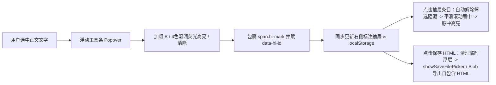

# Plan for: 精读本 HTML 划词标注（加粗/改色）、全局抽屉跳转与自包含保存改造

**问题陈述**：当前 `sh-transcript-reader` 生成的杂志风精读本 HTML（含单人演说 `monologue` 与双人对谈 `dialogue` 双模态）及本次产出的《为什么我不推荐下班学AI？人和人的差距从来不是工具！ - 南大教授刘嘉访谈_精读本.html》为纯只读静态页面。用户在深度精读长文时，无法对核心语句进行划词加粗或背景改色高亮，缺乏全局汇总面板查看所有标注并一键跳转回原文，也无法将标注后的状态持久化导出为独立 HTML 文件。
**需求确认**：
- `[1]=a`：同步升级 `sh-transcript-reader` 的渲染脚本模板（`render_reader.py`）+ 更新本次《刘嘉访谈_精读本.html》；
- `[2]=a`：采用右侧常驻/可折叠抽屉（Drawer，宽屏下可边看原文边看标记列表，窄屏滑出，不遮挡正文且不丢滚动位置）；
- `[3]=b`：除 `localStorage` 本地自动保存外，增加“保存为含标记的独立 HTML 文件”按钮（下载/另存后的 HTML 直接内嵌标记，发给别人或换浏览器打开也在）。
**背景现状**：
- `D:\Users\language_projects\.agents\skills\sh-user-skills\sh-transcript-reader\scripts\render_reader.py` 目前完整实现了 `generate_monologue_html`，而 `dialogue` 分支（第 1074 行）尚缺 `build_turns` 与 `generate_html` 的内联实现；
- 本次生成的《为什么我不推荐下班学AI？人和人的差距从来不是工具！ - 南大教授刘嘉访谈_精读本.html》由 `build_liujia_reader.py` 生成，包含 7 幕导航与 53 轮对谈；
- 遵循 `sh-frontend-deai` 与 `sh-ui-layer-guide` 规范：基底采用纸面暖白 `#FBFBFA`、松针绿 `#1A4432` 与陶土赭 `#8E4A28` 语义色，严禁蓝紫渐变与暗黑赛博风；高频单条删除使用行内就近触发 + 5 秒可撤销（Undo）轻提示条（Toast），不弹模态框打断阅读心流。
**方案架构**：
采用零外部依赖的原生 JavaScript + CSS 注入方案（`file://` 协议离线直开可用），统一封装为 `ANNOTATION_CSS`、`ANNOTATION_UI_HTML` 与 `ANNOTATION_JS` 三个模块，注入到 `render_reader.py`（同时补全 `dialogue` 与 `monologue` 模板）及《刘嘉访谈_精读本.html》：

1. **划词浮动工具条（Selection Popover）**：
   - 监听正文区域（`.dialogue-flow` / `.essay-flow` / `.executive-card`）的 `mouseup` 与 `keyup`，当选中有效非空文本时，在选区上方居中浮现无 AI 味纸面质感工具条：
     - **加粗（`B`）**：切换 `data-hl-bold="true"`（字重加粗 + 松烟墨深色强调）；
     - **四色纸面荧光背景**（温和护眼，适配暖白纸面）：
       - 琥珀黄（`amber`：`#FBF0C4`）
       - 松针绿（`jade`：`#DCF0E4`）
       - 陶土粉（`clay`：`#F9E3D8`）
       - 青黛蓝（`mist`：`#DDEBF4`）
     - **批注/移除**：点击已有 `.hl-mark` 高亮块时，工具条切换为「切换颜色 / 切换加粗 / 移除标记」。
   - 支持跨内联节点的安全包裹（基于 `Range` 提取或单段落精准包裹），每个标记生成唯一 `id="hl-<timestamp>-<rand>"`，并自动记录所属章节/发言人/时间戳上下文。
2. **右侧常驻/可折叠全局标注抽屉（Annotation Drawer）**：
   - 顶部工具栏 `.reader-toolbar` 右侧新增：`📝 标注清单 (N)` 抽屉开关按钮 + `💾 保存含标记 HTML` 按钮；
   - 宽屏（`>=1280px`）展开抽屉时，主阅读容器平滑左移让出右侧 `340px` 空间，实现真正的“边读原文、边看标注”；中窄屏下以右侧滑出面板呈现；
   - 抽屉功能：
     - 顶部筛选（全部颜色 / 仅加粗 / 各色筛选）与「复制 Markdown 摘录」按钮；
     - 列表卡片展示：所属幕次/发言人徽章 + 原文时间戳 + 标记文本预览（对应色标左边框）+ 悬停行内移除按钮；
     - **点击卡片跳转**：若目标段落因「仅嘉宾/仅主持」筛选处于 `.hidden` 状态，自动切回「全文实录」解除隐藏，随后 `scrollIntoView({ behavior: 'smooth', block: 'center' })`，并对目标 `.hl-mark` 施加 1.8 秒暖赭色外发光脉冲动画（`.hl-pulse`）；
     - **防误删可逆体验**：移除单条标注时立即生效，并在底部浮现 5 秒可点击「撤销（Undo）」的轻提示条。
3. **双轨持久化（`localStorage` + 独立自包含 HTML 导出）**：
   - **本地热持久化**：每次增删改标注后，自动将标注 DOM 快照与元数据写入 `localStorage`（以页面标题确定性 key 存储）；直接刷新原始本地文件时自动还原所有标记；
   - **自包含 HTML 导出**：点击「💾 保存含标记 HTML」时，先收起浮动工具条与临时闪烁类，将当前已包含 `` 的完整 DOM 及内嵌状态序列化为纯净 UTF-8 HTML，优先调用 `window.showSaveFilePicker`（支持直接覆盖原文件或另存），不支持时自动回退为 `<标题>_已标注.html` 浏览器下载。导出的 HTML 在任何电脑或浏览器打开均原生自带所有高亮标记，且可继续增删标注。

**任务分解**：
- [x] Task 1: 升级 `sh-transcript-reader` 渲染引擎与 README 文档
  - 文件：`D:\Users\language_projects\.agents\skills\sh-user-skills\sh-transcript-reader\scripts\render_reader.py`、`D:\Users\language_projects\.agents\skills\sh-user-skills\sh-transcript-reader\README.md`
  - 实现：在 `render_reader.py` 中抽离通用标注引擎模块（CSS + 浮动工具条 + 右侧抽屉 + `localStorage` 恢复 + 自包含 HTML 导出），补全 `dialogue` 模式的 `build_turns` 与 `generate_html` 实现并接入 `monologue` 与 `dialogue` 双模板；同步更新 `README.md` 说明新增的划词高亮、全局抽屉跳转与自包含保存特性。
  - 验证：运行 `uv run "D:\Users\language_projects\.agents\skills\sh-user-skills\sh-transcript-reader\scripts\render_reader.py" --help` 确认 CLI 正常，并用脚本提取内嵌 `<script>` 块通过 `node --check` 语法校验。
  - Demo：`sh-transcript-reader` 生成的任意精读本均原生自带划词加粗/改色、右侧标注抽屉与导出 HTML 能力。
- [x] Task 2: 重新生成《刘嘉访谈_精读本.html》并完成端到端交互校验
  - 文件：`D:\Users\appdata-agent-skills\sh-zhangshihao-douyin-dl\douyin\为什么我不推荐下班学AI？人和人的差距从来不是工具！ - 南大教授刘嘉访谈_精读本.html`
  - 实现：将该完整标注系统合入刘嘉访谈精读本生成脚本并重新渲染生成目标 HTML，保持 7 幕 53 轮完整对谈、术语校订、无 BOM UTF-8 编码与去 AI 味版式。
  - 验证：提取生成 HTML 中的全部 JS 脚本通过 `node --check` 零语法错误验证；校验 UTF-8 无 BOM、53 轮对谈标签闭合、划词工具条/右侧抽屉/保存函数与 DOM ID 完整齐备。
  - Demo：在浏览器打开《为什么我不推荐下班学AI？人和人的差距从来不是工具！ - 南大教授刘嘉访谈_精读本.html》，选中任意句子即可加粗或切换 4 种背景色，右侧抽屉实时列出所有标记，点击任一条目平滑滚动至原文对应位置并闪烁提示，点击「保存含标记 HTML」可保存为带标记的独立 HTML 文件。

**执行结果（2026-11-15）**：
- 新增 `scripts/annotation_engine.py`（CSS / 工具条按钮 / 抽屉浮层 / JS 五段资产 + 幂等注入函数），`render_reader.py` 补全 `build_turns`、`generate_html` 双模态接入，并新增 `--inject-only` 原地升级模式；README 升 v1.2.0。
- 原一次性 `build_liujia_reader.py` 已不在工作区，Task 2 改用 `--inject-only` 将同一引擎注入现有《刘嘉访谈_精读本.html》，完整保留 53 轮对谈、act-0 + 七幕结构与术语校订。
- 校验：`uv run render_reader.py --help` 正常；生成页与目标页全部内嵌脚本 `node --check` 通过；目标页无 BOM；无头 Chrome 交互断言 23/23 通过（划词、四色、抽屉、隐藏筛选跳转、撤销、localStorage 还原、自包含导出）；导出 HTML 以 `file://` 独立打开 7/7 通过；跨内联节点选区 6/6 通过。
