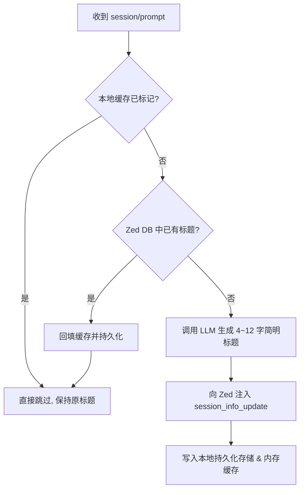

# 修复 AGY ACP 自动标题在重启后覆写为“继续”的实施计划

## 1. 问题背景与根本原因 (Goal Description)

用户在使用 `Google Antigravity (auto-title)` 代理模式时，会话首次提问已成功生成了标题。但当重启（重启 Zed 或重启 agent 进程）后，在原会话中发送下一条消息（如“继续”），会话标题被错误覆写为“继续”。

### 深入复盘：四大诱因
1. **内存状态无持久化（重启归零）**：
   `Titler` 仅在内存中使用 `titledSessions map[string]bool` 跟踪已命名的会话。一旦 Zed 或 proxy 进程重启，映射表重置为空，丢失所有会话的命名状态。
2. **缺乏历史会话感知（未核验 Zed 本地数据库）**：
   Zed 的本地 SQLite (`%LOCALAPPDATA%\Zed\db\0-stable\db.sqlite`) 中明确持久化了所有会话的 `sidebar_threads` 记录（包含 `session_id`、`title`、`title_override`）。Proxy 在处理 `session/prompt` 时未查询 Zed 数据库，直接把历史会话当成新会话处理。
3. **未区分新旧会话生命周期**：
   ACP 协议中只有新创建的会话会收到 `session/new` 回调。当前 `Titler.OnSessionNew` 为空实现，任何 session 只要首见于 `session/prompt`，就会被当成未命名的会话触发标题生成。
4. **低信息量延续词未做过滤**：
   当用户输入“继续”、“好的”、“下一步”等纯流程控制短指令时，LLM 缺乏上下文直接提取出“继续”作为标题，产生语义污染。

---

## 2. 用户审核与关键决策 (User Review Required)

> [!IMPORTANT]
> **极简不变式防御策略**：
> 1. **数据持久化位置**：遵循 Monorepo 规范 §四，持久化数据文件存放于 `%APPDATA%\language_projects\acp-title-proxy\titled_sessions.json`。
> 2. **历史会话双重检查**：在收到任何 `session/prompt` 时，如果本地缓存未命中，自动以只读模式探测 Zed 的 `db.sqlite`。如果该 session 已经存在有效标题，自动载入持久化缓存并直接跳过，绝对禁止再次向 Zed 发送 `session_info_update`。
> 3. **核心不变式：单会话单次命名**：会话生命周期内严格仅允许起名一次，只要已有标题，后续对话一律无条件过滤（Early Return），无需维护脆弱复杂的特定词黑名单。

---

## 3. 未决问题与阻塞确认清单 (Open Questions)

### 未决问题与阻塞确认清单
- [x] ~~针对纯延续词过滤~~ -> 已对齐用户极简原则：依赖“持久化 + Zed DB 查重”核心不变式，已有标题的历史会话后续任何输入一律自然跳过，无需特例词表修补。

---

## 4. 详细改动方案 (Proposed Changes)



### 4.1 新增持久化存储组件 (`internal/store`)

#### [NEW] `internal/store/store.go`
- 职责：管理已命名的会话 ID 集合与标题映射。
- 路径安全：写入 `%APPDATA%\language_projects\acp-title-proxy\titled_sessions.json`，自动递归创建父目录。
- 线程安全：基于 `sync.RWMutex`，内存 map + 原子写入。

### 4.2 增强 Zed 数据库只读探针 (`internal/store/zeddb.go`)

#### [NEW] `internal/store/zeddb.go`
- 职责：只读连接 Zed 的 `%LOCALAPPDATA%\Zed\db\0-stable\db.sqlite`。
- 执行查询：
  ```sql
  SELECT title, title_override FROM sidebar_threads WHERE session_id = ? LIMIT 1
  ```
- 若查询到 `title` 非空且非默认空字符，或 `title_override` 非空，判定为“已有有效标题的历史会话”。

### 4.3 强化 AGY 标题器 (`internal/agy/titler.go`)

#### [MODIFY] `internal/agy/titler.go`
1. 引入持久化存储与 Zed DB 探针支持。
2. 改造 `OnPrompt(sessionID, prompt)`：
   - 检查持久化 store 是否已记录该 session，若是则直接跳过；
   - 检查 Zed DB 是否已存在该 session 的标题，若是则回填 store 并直接跳过；
   - 仅当二者均未命中时，才触发首条标题生成；
   - 生成成功后调用 `store.MarkTitled(sessionID, title)` 持久化。

### 4.4 编译与部署

- 执行单元测试确保回归。
- 编译生成新的 `bin/acp-title-proxy.exe`。
- 重启后台 pre-warm daemon 确保加载最新逻辑。

---

## 5. 验证方案 (Verification Plan)

### 5.1 自动化测试 (Automated Tests)
- `go test -v ./internal/store/...`：验证持久化读写、并发安全与目录自动创建。
- `go test -v ./internal/agy/...`：验证纯延续词过滤、已有标题跳过逻辑、Zed DB 拦截模拟。
- `go test -v ./internal/proxy/...`：端到端模拟测试“首条提问生成标题 -> 模拟重启新进程 -> 收到‘继续’跳过生成”完整闭环。

### 5.2 手动验证流程 (Manual Verification)
1. 在 Zed 中打开一个由 `Google Antigravity (auto-title)` 代理驱动的已有会话（该会话已有标题）。
2. 在该会话中发送“继续”。
3. 检查 Zed 侧边栏：会话标题保持原样，绝不被修改为“继续”。
4. 在 Zed 中新建一个空白会话，发送具体开发任务（如“实现一个 LRU 缓存”），验证正常生成准确标题。
