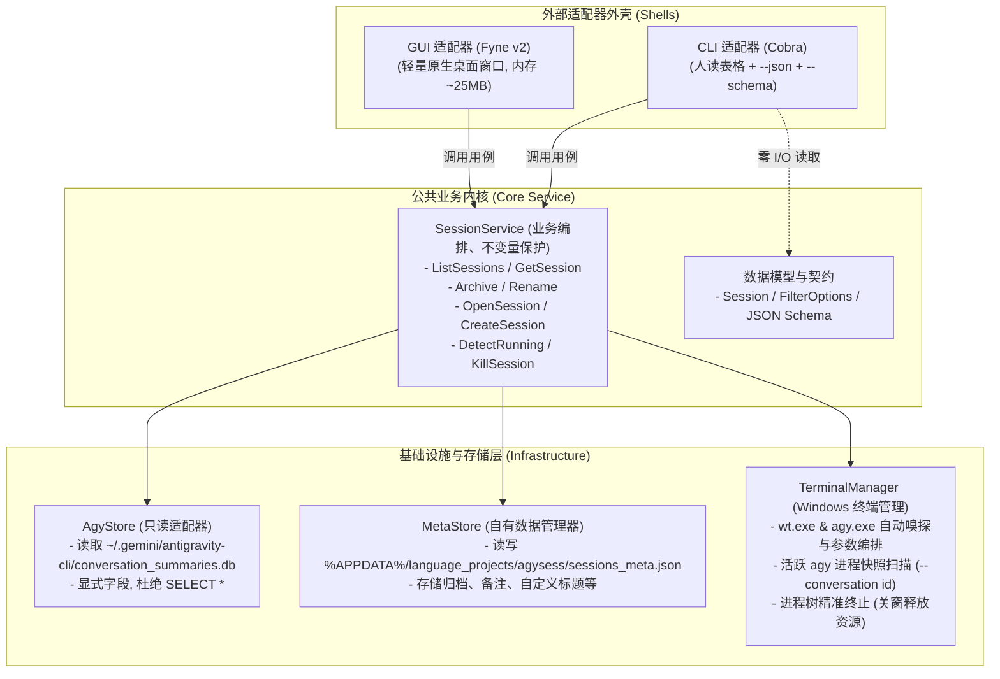

# 实施计划：agysess —— 轻量级 agy CLI 会话管理与 Windows Terminal 联动工具

> 文档状态：待审阅与确认  
> 创建时间：2026-10-31  
> 归属规范：[`docs/projects/go_projects/CLI 工具开发标准.md`](../../../docs/projects/go_projects/CLI%20工具开发标准.md)  
> 项目路径：`go_projects/agysess`  
> 数据路径：`%APPDATA%\language_projects\agysess\`  

---

## 一、需求背景与目标定位

### 1.1 痛点分析
1. **内存开销过重**：Google Antigravity 桌面端应用（Electron + `language_server.exe`）每次启动常驻 1~1.5GB 内存，对系统资源消耗过大；
2. **CLI 缺少会话管理视野**：官方 `agy` CLI 虽然轻量快捷，但原生仅提供 `--conversation <id>` 和 `--continue`，缺乏结构化列表直观展示、检索、多维排序、归档标记与清理机制；
3. **终端窗口割裂与失控**：日常使用 Windows Terminal 打开多个 agy 窗口或标签页后，无法快速从管理器定位并唤起对应会话，且旧会话往往遗留终端窗口占用资源，缺少在管理面板中“一键关闭/回收窗口”的闭环能力。

### 1.2 解决方案与核心特性
打造 **`agysess`**（Antigravity Session Manager）—— 足够轻量的 Go 原生工具：
- **拒绝 Wails / Electron 臃肿包袱**：采用纯 Go + 原生轻量 GUI 库 **Fyne**（`fyne.io/fyne/v2`），启动极速，常驻内存仅数十 MB（~20MB-40MB），彻底摆脱 Chromium / WebView2 运行时内存暴涨；
- **严格遵循《CLI 工具开发标准》v1.0**：
  - **Service 核心驱动，多壳解耦**：公共 Service 层承载会话读取、过滤排序、归档持久化、WT 调度与进程生命周期监控，CLI 壳与 GUI 壳均为外层适配器；
  - **`--json` + `--schema` 第一基石**：CLI 管理与查询命令标配标准 JSON 包络与零 I/O 静态 JSON Schema 导出；
  - **自有数据强隔离**：归档状态、自定义备注等自有数据严格存放在 `%APPDATA%\language_projects\agysess\`，严禁污染 `~/.gemini` 原生数据库；
- **Windows Terminal (WT) 深度联动**：
  - 一键拉起 WT 恢复历史会话：`wt -w 0 new-tab -d "<dir>" agy --conversation <id>`；
  - 一键在 WT 中新建 agy 会话（支持指定项目、模型、工作目录）；
  - 智能探测活跃运行中的 agy 进程，面板直观指示“RUNNING”状态，并支持在面板中“一键关闭对应窗口/回收进程树”。

---

## 二、用例能力表与契约设计

### 2.1 业务能力矩阵（对齐规范 §1.1）

| 业务用例 | CLI 入口 | GUI (Fyne) 面板能力 | 输入、结果与副作用 | 执行方式与差异 | 暴露理由 |
|---|---|---|---|---|---|
| 查询会话列表 | `agysess list` | 主面板会话卡片/表格实时列表 | 筛选词、项目、归档开关、排序方式；返回会话清单 | CLI 支持人读表格与 `--json` 数据下推；GUI 自带搜索与分类切换 | 双入口高频使用 |
| 查看会话详情 | `agysess show <id>` | 点击卡片弹出会话详情面板 | 会话 ID；返回完整元数据与上下文路径 | CLI 支持 `--json`；GUI 弹窗可读渲染 | 诊断与查验 |
| 归档会话 | `agysess archive <id>` | 卡片右键菜单/操作按钮「归档」 | 会话 ID；更新自有数据标记 `is_archived=true` | 写入 `%APPDATA%\...\sessions_meta.json` | 整理归档旧会话 |
| 取消归档 | `agysess unarchive <id>` | 归档视图中点击「恢复」 | 会话 ID；更新自有数据标记 `is_archived=false` | 写入 `%APPDATA%\...\sessions_meta.json` | 误归档恢复 |
| 重命名/备注 | `agysess rename <id> <title>` | 卡片右键「重命名/备注」弹窗 | 会话 ID、自定义标题/备注；更新自有元数据 | 持久化至自有元数据（非侵入原生库） | 个性化辨识 |
| 恢复打开会话 | `agysess open <id>` | 卡片直观按钮「在 WT 打开」 | 会话 ID、可选 `--new-window`；拉起 WT 标签页 | 异步调用 `wt.exe` 注入参数启动 | 核心流线 |
| 新建 agy 会话 | `agysess new` | 顶部主操作按钮「新建会话」 | 工作目录、项目、模型等参数；拉起 WT 新标签 | 交互弹窗选择目录与参数，调用 `wt.exe` | 核心流线 |
| 探测运行中会话 | `agysess running` | 界面自动高亮「RUNNING」绿色徽章 | 无输入；返回活跃 `agy.exe` 会话 ID 与 PID | 扫描进程命令行参数与 WT 进程状态 | 运行态感知 |
| 关闭会话窗口 | `agysess kill <id>` | 运行中卡片红/橙色「关闭窗口」 | 会话 ID、可选 `--force`；回收对应进程树 | 发送优雅退出信号或强制终止对应进程树 | 快速资源释放与关窗 |
| 唤起 GUI 面板 | `agysess gui` | （自身） | 启动 Fyne 桌面窗口 | 阻塞运行原生桌面应用事件循环 | 满足桌面可视化需求 |
| 导出离线契约 | `agysess schema` | 不涉及 | 零 I/O 静态导出所有命令的 JSON Schema | 快速反射，严禁触发数据库连接与 I/O | 机器与 Agent 自描述 |

### 2.2 CLI JSON 包络与退出码契约（对齐规范 §3 与 §4）
- **成功包络**：
  ```json
  {
    "ok": true,
    "data": {
      "items": [
        {
          "id": "ea48ad52-e2af-4a7c-bfc5-98017c064ce7",
          "title": "Fill-in-the-Middle 补全实现",
          "preview": "/research Fill-in-the-Middle",
          "step_count": 8,
          "last_modified_time": "2026-09-22T13:19:49Z",
          "workspace_uris": "D:/Users/language_projects",
          "project_id": "outside-of-project",
          "is_archived": false,
          "is_running": false,
          "pid": 0
        }
      ],
      "total": 1
    }
  }
  ```
- **失败包络**：
  ```json
  {
    "ok": false,
    "error": {
      "code": "session_not_found",
      "message": "未找到指定的 agy 会话: ea48ad52"
    }
  }
  ```
- **退出码契约**：
  - `0`：成功执行；
  - `2`：命令行参数错误或未知选项；
  - `1`：业务失败（如会话未找到、启动 WT 失败、进程未在运行等）。

---

## 三、系统架构与技术选型

### 3.1 架构图



### 3.2 技术选型与极简内存设计
1. **开发语言**：Go 1.25+（本地已备 `go1.25.3 windows/amd64` 与 MSYS2 GCC 15.2.0）；
2. **GUI 框架**：`fyne.io/fyne/v2`：
   - 纯 Go + OpenGL/DirectX 硬件加速渲染，不依赖任何浏览器引擎，启动速度 <100ms；
   - 典型常驻内存仅 20MB~35MB（相比 Electron/Antigravity 的 1.5GB 减少 98% 内存开销）；
   - 内置 Windows 微软雅黑字体自动适配逻辑，彻底杜绝中文字体乱码方块问题；
3. **CLI 框架**：`github.com/spf13/cobra`，提供工业级子命令树与参数解析；
4. **SQLite 驱动**：`modernc.org/sqlite`（纯 Go 实现）或 `github.com/mattn/go-sqlite3`（支持只读模式并发读取，避免锁死）。

---

## 四、核心模块详细设计

### 4.1 数据模型（`internal/model`）
```go
type Session struct {
    ID               string     `json:"id"`
    Title            string     `json:"title"`
    Preview          string     `json:"preview"`
    StepCount        int        `json:"step_count"`
    LastModifiedTime time.Time  `json:"last_modified_time"`
    WorkspaceURIs    string     `json:"workspace_uris"`
    Status           string     `json:"status"`
    ProjectID        string     `json:"project_id"`
    AgentName        string     `json:"agent_name"`
    
    // 自有扩展元数据（来自 MetaStore）
    IsArchived       bool       `json:"is_archived"`
    ArchivedAt       *time.Time `json:"archived_at,omitempty"`
    CustomNotes      string     `json:"custom_notes,omitempty"`
    
    // 动态探测运行态（来自 TerminalManager）
    IsRunning        bool       `json:"is_running"`
    PID              int        `json:"pid,omitempty"`
}
```

### 4.2 只读 Agy 数据库访问（`internal/store/agystore.go`）
- 目标路径：`~/.gemini/antigravity-cli/conversation_summaries.db`；
- 连接模式：`file:...mode=ro` 只读连接，绝不加写锁，不干扰 `agy` CLI 正常运行；
- 查询契约（严禁 `SELECT *`）：
  ```sql
  SELECT conversation_id, title, preview, step_count, last_modified_time, 
         workspace_uris, status, project_id, agent_name 
  FROM conversation_summaries
  ```

### 4.3 自有元数据存储（`internal/store/metastore.go`）
- 存放路径：`%APPDATA%\language_projects\agysess\sessions_meta.json`；
- 写入时确保自动创建完整目录链；
- 记录每个被操作过的会话的 `is_archived`, `archived_at`, `custom_notes`, `custom_title`；
- 读时将 Agy 原生数据与 MetaStore 进行无缝联接（Left Join 逻辑）。

### 4.4 终端与进程管理器（`internal/terminal/manager.go`）
1. **程序路径定位**：
   - `wt.exe`：检查 PATH，探测 `D:\Users\Softwares\WindowsTerminal\wt.exe` 或默认 WindowsApps 路径；
   - `agy.exe`：检查 PATH，探测 `C:\Users\<user>\AppData\Local\agy\bin\agy.exe`；
2. **恢复打开会话**：
   - 提取会话的 `WorkspaceURIs` 作为工作目录；
   - 组装命令：`wt.exe -w 0 new-tab -d "<dir>" --title "agy: <title>" agy.exe --conversation <id>`；
   - 支持独立窗口模式：`wt.exe new-window -d "<dir>" ...`；
3. **新建会话**：
   - 组装命令：`wt.exe -w 0 new-tab -d "<dir>" --title "agy: new" agy.exe [--project <p>] [--model <m>]`；
4. **运行中会话探测（实时探活）**：
   - 扫描当前系统中所有 `agy.exe` 进程及其启动命令行参数（通过 Windows API 或 WMI/CIM 命令行提取）；
   - 正则匹配 `--conversation\s+([a-zA-Z0-9\-]+)`，若匹配到则标记该会话为 `IsRunning = true` 并记录其 `PID`；
5. **在面板中关闭窗口 / 回收进程**：
   - 根据会话 ID 查找到对应 `PID`；
   - 执行树级终止（终止 `agy.exe` 及其所附属的控制台进程，通知 Windows Terminal 对应 tab 正常关闭），释放内存与句柄。

### 4.5 GUI 界面布局设计（`internal/gui`）
基于 Fyne v2 打造简洁现代的深色/浅色自适应界面：
- **顶部操作栏**：
  - 🔍 **搜索输入框**：实时按标题/预览文本/ID 过滤；
  - 📁 **项目筛选下拉框**：全部项目 / 指定项目；
  - 🏷️ **视图切换**：[活跃会话] (默认) / [全部会话] / [仅归档]；
  - 🔃 **排序方式**：按最新修改 (默认) / 按步数降序；
  - ➕ **「新建会话」主按钮**：打开新建对话框（选择目录、模型、项目名）；
  - 🔄 **「刷新」按钮**：重新从 SQLite 与系统进程拉取状态；
- **中间会话列表（主交互区）**：
  - 每个会话作为一张紧凑卡片或表格行：
    - 状态徽章：活跃中显示绿色闪亮徽章 `[RUNNING: PID]`，已归档显示灰色 `[ARCHIVED]`；
    - 标题与修改时间（相对时间如 "5分钟前"）、步数徽章；
    - 所属项目路径或 Workspace 目录；
    - 预览文字摘要（1~2 行浅灰展示）；
  - **操作按钮组**：
    - 🟢 **「在 WT 打开」**：一键在 Windows Terminal 打开或继续该会话；
    - 🛑 **「关闭窗口」**（仅在会话处于 RUNNING 时高亮可用）：一键终止终端进程，回收资源；
    - 📦 **「归档 / 取消归档」**：快捷切换归档标记；
    - ✏️ **「备注/重命名」**：自定义会话名称；
- **底部状态栏**：
  - 显示总会话数、活跃运行中会话数、Agy 数据库路径状态。

---

## 五、实施步骤与任务切片（To-Tickets）

- [ ] **Task 1: 初始化项目结构与公共契约模型**
  - 在 `go_projects/agysess/` 初始化 `go.mod`；
  - 创建 `internal/model`：定义 `Session`, `FilterOptions`, `CreateSessionOptions`, `SessionStats`；
  - 编写静态 JSON Schema 定义，支持 `--schema` 零 I/O 导出。

- [ ] **Task 2: 实现基础设施与存储层**
  - 实现 `internal/store/agystore.go`：只读打开 `~/.gemini/antigravity-cli/conversation_summaries.db`，严格显式指定列名，杜绝 `SELECT *`；
  - 实现 `internal/store/metastore.go`：管理 `%APPDATA%\language_projects\agysess\sessions_meta.json`，支持归档、备注等自有数据持久化。

- [ ] **Task 3: 实现 Windows Terminal 与进程管理层**
  - 实现 `internal/terminal/manager.go`：
    - 自动嗅探 `wt.exe` 与 `agy.exe` 路径；
    - 实现 `OpenConversation` 与 `NewConversation` 命令行组装与启动；
    - 实现 Windows 活跃 `agy.exe` 进程探测（提取 `--conversation <id>` 映射）；
    - 实现 `KillSessionProcess` 树级终止逻辑。

- [ ] **Task 4: 实现公共 Service 核心层**
  - 实现 `internal/service/session_service.go`：
    - 编排会话数据合并（Agy SQLite + MetaStore + Terminal 运行态）；
    - 提供 `ListSessions`, `GetSession`, `ArchiveSession`, `UnarchiveSession`, `UpdateNotes`, `OpenSession`, `CreateSession`, `KillSession` 等纯业务接口；
    - 编写单元测试验证业务不变量。

- [ ] **Task 5: 实现 CLI 适配器外壳**
  - 基于 Cobra 组装命令树：
    - `agysess list`（人读表格、`--json` 标准包络、`--schema`、投影参数支持）；
    - `agysess show <id>`；
    - `agysess archive <id>` / `unarchive <id>`；
    - `agysess open <id>`；
    - `agysess new`；
    - `agysess running`；
    - `agysess kill <id>`；
    - `agysess schema`；
  - 落实退出码 0/1/2 契约与标准流分流。

- [ ] **Task 6: 实现 Fyne 原生 GUI 适配器外壳**
  - 引入 `fyne.io/fyne/v2` 依赖；
  - 注入 Windows 原生字体回退适配（解决中文方块）；
  - 实现主界面（顶部工具栏、会话卡片列表、底部状态栏）；
  - 实现交互联动：一键 WT 打开、运行中绿色徽章与一键关窗、新建会话弹窗、归档切换与实时过滤。

- [ ] **Task 7: 组装入口与双模引导**
  - 编写 `cmd/agysess/main.go`：
    - 默认命令行模式；
    - `agysess gui` 或双击无参检测自适应唤起 GUI；
  - 调优编译参数（`-ldflags="-s -w -H=windowsgui"` 可选打包双模或独立 GUI 运行）。

- [ ] **Task 8: 规范验收与文档归档**
  - 依据《CLI 工具开发标准》§9 进行全项验收（CLI 人读、`--json`、`--schema` 零 I/O、WT 联动、运行中探活与关窗、Fyne 内存占用测量）；
  - 验证运行内存是否严格控制在 20MB~40MB（对比 Antigravity 桌面端 1.5GB）；
  - 编写项目镜像文档 `docs/projects/go_projects/agysess/README.md`。

---

## 六、关键技术难点与防御措施

| 潜在风险/技术点 | 风险分析 | 防御措施 |
|---|---|---|
| **SQLite 并发读冲突** | `agy` CLI 或 Antigravity App 运行时可能持有数据库写锁 | 采用 SQLite URI 只读模式 `file:...mode=ro&_txlock=deferred`，保证即使外部写入，本工具也能零阻塞读取快照，绝不引发锁冲突 |
| **中文字体乱码（方块）** | Fyne 默认英文字体在 Windows 上渲染中文会显示为方块 | 在 GUI 初始化阶段自动检测 Windows 系统字体（如 `C:\Windows\Fonts\msyh.ttc`），通过 `FYNE_FONT` 环境变量或自定义 Theme 注入中文字体，确保中文丝滑渲染 |
| **关窗残留孤儿进程** | 普通 `kill` 可能仅杀掉外层 shell，遗留子进程常驻 | 采用 Windows 进程树级安全回收（`taskkill /PID <pid> /T /F` 或调用系统 Job Object API），确保整棵进程树与终端标签页彻底回收，立即释放全部系统内存 |
| **WT 路径差异** | 不同用户可能使用独立便携版 WT 或 Windows 应用商店版 WT | 采用渐进式嗅探器：优先探测已运行的 WT 实例与用户自定义/便携路径（如 `D:\Users\Softwares\WindowsTerminal\wt.exe`），其次读取 PATH 环境变量，最后回退 LocalAppData 商店路径 |
| **契约零 I/O 铁律** | 规范要求 `<prog> schema` 严禁触发任何 I/O | 静态 Schema 结构由结构体反射或预置常量提供，在解析到 `schema` 命令分支时直接序列化输出并退出，绕过数据库连接与网络初始化 |
