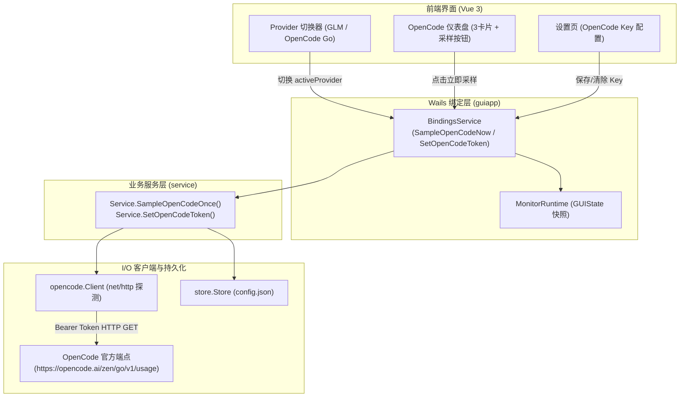

# Design Document: OpenCode Go 额度探测快速实现

## Overview

在 `glmquotawatch-gui` 中快速引入 OpenCode Go 额度探测能力，提供端到端的 API 探测、配置持久化、CLI 独立子命令和 GUI 专属仪表盘。通过 Provider 隔离设计，保持原有 GLM 监控链路 100% 独立稳定，以最轻量优雅的方式支持用户即时查看 OpenCode Go 的三大配额窗口（滑动窗口、周窗口、月窗口）。

## Context

OpenCode Go 官方用量接口规范已实测探明：
- **端点**：`GET https://opencode.ai/zen/go/v1/usage`
- **鉴权**：`Authorization: Bearer <API_KEY>`（格式形如 `oc_sk_...`）
- **响应体**：
  ```json
  {
    "usage": {
      "rolling": {
        "status": "ok",
        "percent": 0,
        "resetsAt": "2026-10-14T05:21:41.000Z"
      },
      "weekly": {
        "status": "ok",
        "percent": 3,
        "resetsAt": "2026-10-19T00:00:00.000Z"
      },
      "monthly": {
        "status": "ok",
        "percent": 83,
        "resetsAt": "2026-10-20T17:59:00.000Z"
      }
    }
  }
  ```
- **错误形式**：HTTP 401（未授权/Key 无效）、HTTP 403（未订阅 Go 套餐），返回 `{"type":"error","error":{"type":"AuthError"|"EntitlementError","message":"..."}}`。

当前 `glmquotawatch-gui` 架构为：
- Go 后端（Cobra CLI + Wails v3 Service 核心 + Store 本地存储）
- 前端（Vue 3 + Tailwind CSS）

## Goals and Non-Goals

- **Goals**:
  1. 新建 `internal/opencode` 客户端模块，封装 HTTP 探测与错误处理。
  2. 扩展 `internal/store`，支持 `opencode_token` 持久化与脱敏。
  3. 在 `internal/service` 编排 OpenCode 探测与配置业务逻辑。
  4. 扩展 `internal/cli`，增加 `opencode` 独立子命令（`status`、`token`）。
  5. 扩展 `internal/guiapp`，暴露 Wails Bindings 并维护前端全局快照中的 Provider 状态。
  6. 前端实现 Provider 切换、OpenCode 专属卡片式仪表盘与设置页 Key 维护。
- **Non-Goals**:
  1. 第一步不实现 OpenCode Go 的后台常驻定时轮询与 Windows Toast 阈值告警。
  2. 第一步不记录 OpenCode Go 的历史用量到 `samples-*.jsonl`，亦不绘制历史曲线。
  3. 不引入第三方网络库或图表组件，保持零新增依赖。

## Detailed Design

### 模块详细划分

#### 1. `CREATED` `internal/opencode/client.go` & `client_test.go`
- **Purpose**: OpenCode Go 官方 API 客户端与数据模型定义。
- **Complexity**: Low
- **Design Details**:
  ```go
  package opencode

  const (
      DefaultBaseURL = "https://opencode.ai/zen/go/v1"
      EnvBaseURL     = "OPENCODE_GO_API_BASE"
  )

  type WindowUsage struct {
      Status   string `json:"status"`   // "ok" | "rate-limited"
      Percent  int    `json:"percent"`  // 0..100
      ResetsAt string `json:"resetsAt"` // ISO 8601
  }

  type Usage struct {
      Rolling WindowUsage `json:"rolling"`
      Weekly  WindowUsage `json:"weekly"`
      Monthly WindowUsage `json:"monthly"`
  }

  type Client struct {
      BaseURL string
      Token   string
      HTTP    *http.Client
  }

  func NewClient(baseURL, token string) *Client
  func (c *Client) FetchUsage(ctx context.Context) (*Usage, error)
  ```
- **错误分类**：
  - 401: `ErrUnauthorized` ("auth_error: API key 无效或未授权")
  - 403: `ErrForbidden` ("entitlement_error: 需要 OpenCode Go 订阅")
  - 其他 HTTP 错误或网络超时封装为清晰的 `*Error`。

#### 2. `UPDATED` `internal/store/store.go`
- **Purpose**: 配置结构支持 OpenCode API Token。
- **Complexity**: Low
- **Changes**:
  - `Config` 结构体追加字段：
    ```go
    type Config struct {
        Token         string `json:"token"`
        OpenCodeToken string `json:"opencode_token,omitempty"`
        Interval      string `json:"interval"`
        Thresholds    []int  `json:"thresholds"`
        Hysteresis    int    `json:"hysteresis"`
        Silent        bool   `json:"silent"`
    }
    ```
  - `LoadConfig()` 与 `SaveConfig()` 原生支持，旧版文件解析时 `OpenCodeToken` 自动为空，双向兼容。

#### 3. `CREATED` `internal/service/opencode.go`
- **Purpose**: OpenCode 业务用例编排与视图模型组装。
- **Complexity**: Low
- **Design Details**:
  ```go
  type OpenCodeConfigView struct {
      Token    string `json:"token"`
      HasToken bool   `json:"has_token"`
      Dir      string `json:"dir"`
  }

  type OpenCodeWindowView struct {
      Name          string `json:"name"`            // "rolling" | "weekly" | "monthly"
      Label         string `json:"label"`           // "滑动短期窗口" | "本周窗口" | "本月窗口"
      Status        string `json:"status"`          // "ok" | "rate-limited"
      Percent       int    `json:"percent"`         // 0..100
      ResetsAt      string `json:"resets_at"`       // ISO 8601
      ResetIn       string `json:"reset_in"`        // 人读倒计时，如 "3h25m"
  }

  type OpenCodeStatusView struct {
      SampledAt string               `json:"sampled_at"`
      Windows   []OpenCodeWindowView `json:"windows"`
  }

  func (s *Service) GetOpenCodeConfig() OpenCodeConfigView
  func (s *Service) SetOpenCodeToken(token string) (OpenCodeConfigView, error)
  func (s *Service) RemoveOpenCodeToken() (OpenCodeConfigView, error)
  func (s *Service) SampleOpenCodeOnce(ctx context.Context) (OpenCodeStatusView, error)
  ```
- **Token 解析策略**：优先取 `store.Config.OpenCodeToken`，为空时回退读取环境变量 `OPENCODE_API_KEY`。

#### 4. `CREATED` `internal/cli/opencode.go` & `UPDATED` `internal/cli/root.go`
- **Purpose**: 增加 `opencode` 顶级子命令组，保持恒 JSON 信封输出。
- **Complexity**: Low
- **Commands**:
  - `opencode token set <key>`
  - `opencode token show`
  - `opencode token remove`
  - `opencode status`
- **Schema 导出**：在 `internal/cli/schema.go` 中注册 `opencode` 命令树，`glmquotawatch-gui schema` 零 I/O 导出完整契约。

#### 5. `UPDATED` `internal/guiapp/bindings.go` & `runtime.go`
- **Purpose**: 扩展 Wails 前端状态与绑定服务。
- **Complexity**: Medium
- **Changes**:
  - `GUIState` 新增字段：
    ```go
    ActiveProvider string                     `json:"active_provider"` // "glm" | "opencode"
    OpenCodeStatus *service.OpenCodeStatusView `json:"opencode_status"`
    OpenCodeConfig *service.OpenCodeConfigView `json:"opencode_config"`
    ```
  - `BindingsService` 暴露方法：
    ```go
    func (b *BindingsService) SetActiveProvider(provider string) error
    func (b *BindingsService) SampleOpenCodeNow() (service.OpenCodeStatusView, error)
    func (b *BindingsService) SetOpenCodeToken(token string) (service.OpenCodeConfigView, error)
    func (b *BindingsService) RemoveOpenCodeToken() (service.OpenCodeConfigView, error)
    ```

#### 6. `UPDATED` 前端组件与页面（Vue 3）
- **Purpose**: 前端支持 Provider 切换、OpenCode 专属仪表盘与设置页配置。
- **Complexity**: Medium
- **Changes**:
  - `frontend/src/api.ts`：导出新增的 OpenCode 相关类型。
  - `frontend/src/store.ts`：维护 `activeProvider` 与 `openCodeStatus`，提供 `sampleOpenCodeNow()` 动作。
  - `frontend/src/App.vue`：顶部导航栏添加精简轻奢的 Provider 切换胶囊按钮 `[智谱 GLM | OpenCode Go]`。
  - `frontend/src/pages/Dashboard.vue`：根据 `activeProvider` 分流展示：
    - `glm`：保留现有 GLM 仪表盘；
    - `opencode`：渲染 OpenCode 专属视图（未配置 Key 时显示引导卡片；已配置时渲染 3 个精制卡片：滑动窗口、周窗口、月窗口，含百分比、进度条、状态灯、倒计时与「立即采样」按钮）。
  - `frontend/src/pages/Settings.vue`：增加 OpenCode API 密钥维护卡片（支持保存、清除与脱敏展示）。

## Module Collaboration and Data Flow



## Acceptance Criteria Mapping

| AC ID | Design Component |
|---|---|
| AC-1 | `internal/cli/opencode.go` + `internal/store/store.go` + `internal/service/opencode.go` (Token set/show 脱敏) |
| AC-2 | `internal/cli/opencode.go` + `internal/opencode/client.go` (`opencode status` JSON 信封) |
| AC-3 | `internal/opencode/client.go` + `internal/service/opencode.go` (401 AuthError / 403 EntitlementError 规范映射) |
| AC-4 | `frontend/src/App.vue` + `Dashboard.vue` + `internal/guiapp/bindings.go` (Provider 切换与卡片展示) |
| AC-5 | 既有 `internal/service/service.go`、`internal/cli/root.go` 及 GLM 组件完全保持原逻辑与不变式 |

## Design Review Notes

- **Q1: 为什么采用独立命名空间 `opencode` 而不是在原有命令加 `--provider`？**  
  **回应**：根据《CLI 工具开发标准》与 Unix 原则，各供应商的数据结构、窗口周期与认证机制不尽相同。独立命令组 `opencode status` 与 `status` 边界清晰，避免 flag 膨胀和破坏已有调用方的脚本假设。
- **Q2: 为什么第一步不开启后台轮询与 Toast 告警？**  
  **回应**：符合用户明确的“第一步可以先快速实现...让我很方便立刻查看现在的额度情况”原则。即时探测只需被动触发，零后台开销与锁竞争，风险极低且交付极快；告警记账可在第二步从容设计。
