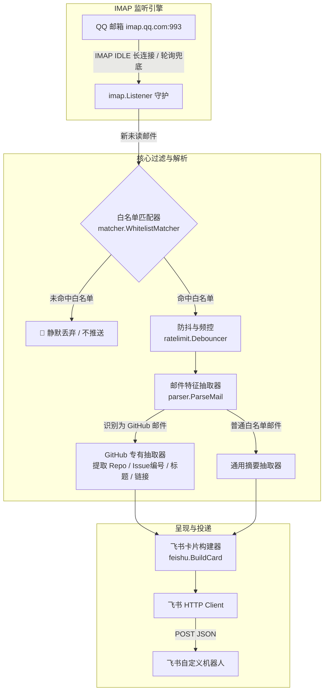

# Plan for: mail2feishu (QQ邮箱至飞书白名单智能推送器)

**问题陈述**：
用户使用 QQ 邮箱接收各类邮件，但手机不希望开启邮箱全局通知（噪音过大）；由于未开启通知，导致 GitHub 提 Issue 等重要回复经常滞后一天才被注意到。用户需要一个在电脑端（通过飞书机器人 Webhook 推送）提醒的 Go 工具，具备严格的白名单机制（未配置的邮件完全阻断不推送），并具备防抖节流机制避免频繁打扰。

**需求确认**：
1. **落位规范**：代码工程落位于 `D:\Users\language_projects\go_projects\mail2feishu`；依仓库 AGENTS.md 约定，计划与文档统一镜像到父仓 `docs/projects/go_projects/mail2feishu/plans/`，子仓内禁止建文档目录。
2. **纯白名单模式**：默认全阻断（Zero-Trust），仅当邮件严格命中用户配置的白名单规则（如 GitHub 域名、指定 VIP 发件人、指定关键词）时才处理并推送，其余邮件彻底静默。
3. **推送通道与交互**：推送到用户的飞书群自定义机器人 Webhook。PC 端飞书弹窗提示，移动端可在飞书内将该群单独静音。推送采用飞书交互式卡片，特化提取 GitHub Issue/PR 链接并提供一键直达按钮。
4. **频率控制**：加入防抖窗口（Debounce）与单讨论串冷却时间，防止连续回复频繁刷屏。

**背景现状**：
1. QQ 邮箱支持标准 IMAP/SSL 协议 (`imap.qq.com:993`)，支持 IMAP IDLE 实时长连接推送事件，配合授权码使用。
2. 本机环境为 Windows，Go 开发环境已就绪。
3. 飞书自定义机器人 Webhook 已提供，支持富文本 Interactive Card。

**方案架构**：

**任务分解**：

- [ ] Task 1: 初始化工程结构、配置模型与白名单匹配引擎
  - 文件：`go_projects/mail2feishu/go.mod`, `go_projects/mail2feishu/config.yaml.example`, `go_projects/mail2feishu/internal/config/config.go`, `go_projects/mail2feishu/internal/matcher/whitelist.go`
  - 实现：初始化 Go 模块；定义配置结构体（支持 IMAP 账号密码、飞书 Webhook、频控参数与白名单规则列表）；实现白名单匹配器（支持精确发件人、发件人域名后缀、主题关键词匹配，默认全阻断）。
  - 验证：在 `go_projects/mail2feishu` 执行 `go test ./internal/matcher -v`，断言白名单匹配与非白名单全拦截行为。
  - Demo：非白名单发件人返回 `false`，GitHub 发件人或指定 VIP 返回 `true`。

- [ ] Task 2: 实现飞书 Webhook 交互卡片生成与 HTTP 投递器
  - 文件：`go_projects/mail2feishu/internal/feishu/client.go`, `go_projects/mail2feishu/internal/feishu/card.go`
  - 实现：封装飞书开放平台 Webhook 发送逻辑（带超时与重试）；构建飞书 Interactive Card V2 格式 JSON，支持标题栏颜色区分、多行信息摘要（发件人、仓库、讨论串）以及跳转外部链接按钮（直达 GitHub Issue）。
  - 验证：在 `go_projects/mail2feishu` 编写并执行投递测试，向目标 Webhook 发送一条测试卡片，收到 HTTP 200 与 `{"code":0}`。
  - Demo：飞书群立即弹出一张排版精美的卡片，附带可点击的跳转按钮。

- [ ] Task 3: 实现通用与 GitHub 专有邮件解析抽取器
  - 文件：`go_projects/mail2feishu/internal/parser/parser.go`, `go_projects/mail2feishu/internal/parser/github.go`
  - 实现：利用 `github.com/emersion/go-message` 解析邮件 MIME 结构与正文；针对 GitHub 邮件（`notifications@github.com`），使用正则与 Header (`List-ID`, `X-GitHub-Reason`) 精准解析出仓库全名、Issue/PR 标题、评论作者与直达 URL。
  - 验证：在 `go_projects/mail2feishu` 执行 `go test ./internal/parser -v`，解析真实 GitHub 样例邮件，验证链接与标题抽取无误。
  - Demo：传入 GitHub 邮件内容，精准输出 `https://github.com/.../issues/...` 链接及摘要。

- [ ] Task 4: 实现 IMAP IDLE 实时监听守护与防抖频控器
  - 文件：`go_projects/mail2feishu/internal/imap/listener.go`, `go_projects/mail2feishu/internal/ratelimit/debouncer.go`
  - 实现：基于 `github.com/emersion/go-imap/client` 实现 SSL 连接 `imap.qq.com:993`；开启 IDLE 模式等待新邮件事件；网络闪断时自动指数退避重连；引入线程防抖器，指定窗口期（如 15s）内同一 Issue/Thread 聚合为一条推送。
  - 验证：执行 `go test ./internal/ratelimit -v`，验证 15s 内多次连续触发聚合为一次调用。
  - Demo：快速连续触发事件被合并，仅触发一次回调。

- [ ] Task 5: 装配 main 进程、配置加载与后台守护运行支持
  - 文件：`go_projects/mail2feishu/main.go`, `go_projects/mail2feishu/run_background.vbs`
  - 实现：串联 Config -> Matcher -> IMAP Listener -> Parser -> Feishu Client 全链路；捕获 SIGINT/SIGTERM 信号实现优雅退出；提供 Windows 后台无窗口静默启动脚本 `run_background.vbs`。
  - 验证：在 `go_projects/mail2feishu` 执行 `go build -o mail2feishu.exe main.go`，二进制构建成功无报错。
  - Demo：运行 `.\mail2feishu.exe -config config.yaml` 启动后常驻，终端输出“IMAP IDLE 已连接，白名单模式运行中”。
