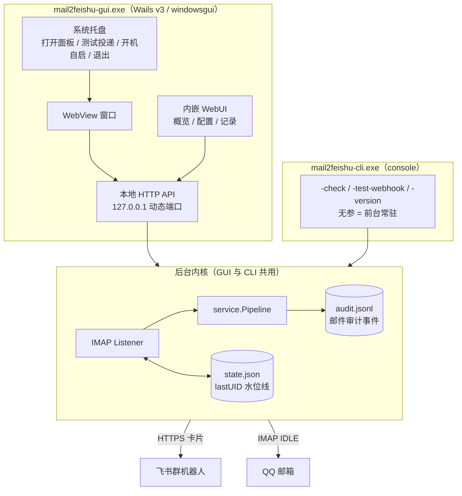

# Plan for: mail2feishu 桌面化（状态持久化 + 审计日志 + Wails 托盘）

**问题陈述**：
当前 mail2feishu 是纯后台 CLI：进程重启后 UID 水位线归零，停机期间邮件被当作历史跳过；被白名单过滤的邮件无任何记录，规则写错时无法排查；无托盘、无开机自启、无配置/数据界面。本次将其升级为常驻桌面应用，同时保留可脚本化的 CLI 通道。

**需求确认**（用户原话决策）：
1. **lastUID 持久化**：写入数据目录，重启后从上次水位线继续拉取，停机期间邮件不丢。
2. **审计日志**：记录全部邮件元信息（UID、发件人、主题、命中规则/丢弃原因、处理结果），不记录正文与凭证；日志按大小轮转。
3. **托盘与界面 = a**：Wails v3 完整桌面壳，托盘 + 配置编辑 + 最近邮件/推送记录/日志面板。
4. **开机自启 = a**：注册表 HKCU\Run；按仓库规范仅 release 版允许写入，dev 版菜单置灰禁用。
5. **日志粒度 = a**：只记元信息，不记正文摘要。

**背景现状**：
1. 现有内核已分层且可复用：`internal/imap`（IDLE + 水位线内存态）、`internal/parser`、`internal/matcher`、`internal/ratelimit`、`internal/feishu`、`internal/service`。
2. 现状缺陷：`lastUID` 只存内存（`internal/imap/listener.go:49`），进程重启后由 `UIDNEXT-1` 重建基线；`pipeline.HandleMail` 对未命中邮件只写运行日志，无结构化审计。
3. 参考样板 `go_projects/taskbarguard`：Wails v3 beta.33 + Go 内嵌 WebUI（无 Node 前端构建链）+ 双通道产物（`-gui` windowsgui / `-cli` console）+ go-winres 注入 VERSIONINFO/manifest/图标 + Wails SingleInstance/Autostart + dev 地鼠图标 / release 专属图标。
4. 工具链已就绪：`wails3.exe`、`go-winres.exe`、`rsrc.exe` 均在 `~/go/bin`；Wails v3 要求 Go 1.26（go.mod 需从 1.25.3 升至 1.26.0，工具链自动下载）。
5. 仓库规范：GUI/托盘项目必须配套专属图标流水线（禁止地鼠应付 release）；dev/prod 数据隔离；单实例互斥 ID 必须区分 dev/prod；dev 版禁止写开机自启注册表。

**方案架构**：

**关键设计**：
- **单实例**：新增命名互斥 `shihao.langproj.mail2feishu.instance[.dev]`，GUI 与 CLI 共用；拿不到锁即拒绝启动（GUI 聚焦已有窗口），杜绝两个进程同时监听造成重复推送。
- **水位线**：`state.json` 记录 `{version, username, last_uid, updated_at}`，原子写（tmp + rename）；username 变更时忽略旧水位线重建基线；文件损坏时告警并回退基线，不阻塞启动。
- **审计事件**：JSONL 追加。`mail` 事件记录 UID/From/Subject/动作（whitelisted/dropped）/规则/原因/线程；`push` 事件记录线程、成功与否、耗时、错误。10MB 轮转保留 3 份。
- **双通道**：`mail2feishu-gui[-dev].exe` 双击零黑框、`--hidden` 静默托盘；`mail2feishu-cli[-dev].exe` 保留全部 CLI 语义（终端/脚本/Agent 使用）。
- **图标**：release 由 `scripts/render_icon.py` 生成绿色圆角底 + 白色信封/纸飞机的 1024 PNG 与多尺寸 ICO；dev 使用地鼠 `icon_dev.ico`；窗口与托盘显式 `SetIcon`。

**任务分解**：

- [x] Task 1: UID 水位线持久化
  - 文件：`go_projects/mail2feishu/internal/state/state.go`、`internal/state/state_test.go`、`internal/imap/listener.go`、`internal/imap/listener_test.go`
  - 实现：新增 `state.Store`（Load/SaveLastUID/Snapshot，原子写）；Listener 注入 `StateStore` 接口，启动时优先读取持久化水位线，无记录/账号不匹配时用 `UIDNEXT-1` 建基线；每批 FETCH 结束落盘一次；损坏文件告警后回退。
  - 验证：`go test ./internal/state ./internal/imap -v`；断言重启后从上次 UID 继续、账号变更重置、损坏文件不阻塞。
  - Demo：手动重启进程，日志显示「从持久化水位线 UID N 继续」，停机期间邮件在启动后被补拉。

- [x] Task 2: 结构化审计日志
  - 文件：`go_projects/mail2feishu/internal/audit/audit.go`、`internal/audit/audit_test.go`、`internal/service/pipeline.go`、`internal/service/pipeline_test.go`
  - 实现：新增 JSONL 审计器（线程安全、按大小轮转、`audit.jsonl` + `.1`/`.2`）；Pipeline 注入 `Auditor` 接口，解析后立即记录 `mail` 事件（whitelisted/dropped + 规则/原因/线程），推送完成记录 `push` 事件（成功/失败/耗时/错误）；不写正文与凭证。
  - 验证：`go test ./internal/audit ./internal/service -v`；断言未命中必留 `dropped` 记录、推送成功/失败各留事件、轮转生效。
  - Demo：发一封非白名单邮件，`audit.jsonl` 出现 `action:"dropped"`；命中邮件出现 `whitelisted` 与 `pushed`。

- [x] Task 3: Wails GUI 壳、托盘、单实例与开机自启
  - 文件：`go_projects/mail2feishu/cmd/mail2feishu/main.go`（`!cli`）、`cmd/mail2feishu/cli.go`（`cli`）、`internal/app/gui.go`、`internal/app/log.go`、`internal/app/autostart.go`、`internal/app/instance.go`、`internal/buildinfo/buildinfo.go`、`go.mod`
  - 实现：Wails v3 `application.New`（SingleInstance、`DisableQuitOnLastWindowClosed`、WebView2 数据目录落在数据目录）；托盘菜单（打开面板 / 测试投递 / 开机自启 / 彻底退出）；自启走 Wails Autostart，dev 版置灰并拒绝写入；命名互斥保证 GUI/CLI 单监听；日志同时写 stderr 与数据目录。
  - 验证：`go build -tags dev ./cmd/mail2feishu`；启动后系统托盘出现图标，菜单项可用；dev 版自启菜单置灰。
  - Demo：托盘右键可打开窗口、退出；重复启动第二实例被拒绝并聚焦已有窗口。

- [x] Task 4: WebUI 与本地 HTTP API
  - 文件：`go_projects/mail2feishu/internal/api/server.go`、`internal/api/server_test.go`、`internal/web/embed.go`、`internal/web/assets/index.html`、`style.css`、`app.js`
  - 实现：Go 1.22 路由 + `{ok,data,error}` 包络；`GET /api/status`、`GET/PUT /api/config`（password/secret 掩码，留空表示不修改）、`GET /api/records?limit=`、`GET /api/logs?tail=`、`POST /api/test-webhook`、`POST /api/reconnect`；前端浅色绿主题、圆角卡片、三页签（概览/配置/记录），配置含白名单规则增删。
  - 验证：`go test ./internal/api -v`；启动 GUI 后打开面板，保存配置后 `config.yaml` 变更且凭证未被清空。
  - Demo：页面实时展示连接状态、水位线、最近邮件审计表；修改白名单并保存后立即生效（重连）。

- [x] Task 5: 专属图标流水线与双通道构建
  - 文件：`go_projects/mail2feishu/scripts/render_icon.py`、`icon.png`、`icon.ico`、`internal/app/icon.go`、`internal/app/icon_dev.go`、`winres/gui.json`、`winres/cli.json`、`wails.exe.manifest`、`scripts/build.py`、`.gitignore`
  - 实现：Pillow 绘制绿色圆角底 + 白色信封/纸飞机图标（1024 PNG + 256/128/64/48/32/24/16 ICO）；release 用专属图标、dev 用地鼠；go-winres 注入 VERSIONINFO + manifest + icon；GUI 使用 `-H windowsgui`，CLI 保持 console；产物 `bin/mail2feishu-gui[-dev].exe` 与 `bin/mail2feishu-cli[-dev].exe`，版本/模式/commit 经 ldflags 注入。
  - 验证：`uv run scripts/build.py` 产出 4 个二进制；检查 PE 属性面板版本与图标；GUI 双击无黑框、CLI 管道输出正常。
  - Demo：任务栏/托盘/窗口图标为专属绿色信封图标；dev 产物一眼可辨（地鼠）。

- [x] Task 6: 装配、迁移与文档收尾
  - 文件：`go_projects/mail2feishu/internal/app/service.go`、`cmd/mail2feishu/cli.go`、`run_background.vbs`、`README.md`、`config.yaml.example`、`.gitignore`
  - 实现：GUI 启动时后台拉起 Listener + Pipeline，退出时按 `stop listener → pipeline.Close → state flush` 顺序优雅收尾；CLI 无参常驻与全部 flag 保留；VBS 改为启动 GUI `--hidden`；README 更新能力表、运行方式、数据文件（config/state/audit/log）与构建产物命名。
  - 验证：`go test ./... -race`、`go vet ./...`、`uv run scripts/build.py`；手动冒烟：托盘退出后进程消失、重启续拉、审计可查。
  - Demo：完整闭环——托盘启动 → 收信 → 审计记录 → 面板查看 → 退出 → 重启续拉。

### 未决问题与阻塞确认清单

- [x] 双产物（`-gui` + `-cli`）：已确认采用双产物。GUI 启动即完整服务（监听/推送/审计），窗口只是控制面板；CLI 用于排障命令与无界面常驻，两者单实例互斥。
- [x] GUI 配置页允许修改凭证：已确认允许，密码/secret 留空表示不修改。
- [x] 图标风格：绿色圆角底 + 白色信封/纸飞机，已确认。
- [x] 审计日志 10MB × 3 份：已确认。
- [x] `run_background.vbs`：保留，改为启动 `mail2feishu-gui.exe --hidden`。
