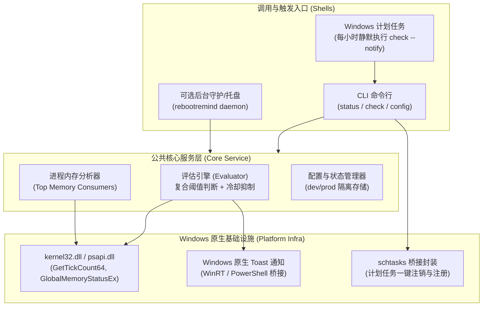

# rebootremind 实现计划：Windows 开机时长与内存健康巡检重启提醒工具

## 1. 目标与背景分析

### 1.1 背景痛点
- **系统慢性内存泄漏与碎片化**：Windows 长期不重启时，非分页池（Non-paged Pool）、驱动缓存以及众多大型 Electron / V8 运行时软件（如 Chrome、Zed、微信、飞书等）的内存堆碎片化严重，私有工作集（Private Bytes）单调递增不返还系统。
- **用户实测现象**：电脑刚重启后开齐常用软件，内存维持在 70%~80%；长期未重启则轻松堆积至 90%+ 甚至导致系统卡顿、换页延迟。
- **核心诉求**：在系统长期未重启且内存处于高位时，及时通过体贴且精准的提醒通知用户重启，并能清晰展示是哪些进程吃掉了内存。

### 1.2 方案选型深度对比：Go 独立工具 vs Windhawk Mod

| 维度 | Go 独立项目（推荐） | Windhawk Mod |
| :--- | :--- | :--- |
| **系统稳定性** | **极高**：独立用户态进程，与 Explorer 零耦合，绝无卡死任务栏或蓝屏风险 | **中低**：侵入式 C++ 钩子注入 `explorer.exe`，崩溃将直接导致任务栏闪烁重启 |
| **常驻资源占用** | **0 内存常驻**（通过 Windows 计划任务定时唤醒检测，用完即退）；亦可选择轻量托盘驻留（约 6~8MB） | 依赖 Windhawk 框架进程常驻，并增加 Explorer 进程内存消耗 |
| **诊断与分析能力** | **极强**：毫秒级扫描并排序当前 **Top 5 / Top 10 内存大户进程**，输出结构化数据 | 仅能获取简单系统指标，在 Explorer 钩子内遍历全系统进程容易引发掉帧 |
| **交互与提醒能力** | **原生现代化**：触发标准 Windows 10/11 Toast 通知（带重启按钮、稍后提醒、详细信息），提供丰富 CLI 查询与 `--json` | 任务栏绘图/文本修改，无法承载多维度健康报告与交互按钮 |
| **仓库工程标准** | 契合 `go_projects` 体系：Service 核心 + CLI + `--json`/`--schema` + `build.py` 隔离 + PE 图标 | 需 C++ 编译环境，目前 `native_projects` 本地处于注销态，维护成本高 |

> [!TIP]
> **结论建议**：以 Go 项目（命名为 `rebootremind`）作为主体方案。通过原生 Windows API 采集开机时长、物理内存以及 Top 内存进程；通过复合规则（开机天数 + 内存水位）智能判断，并通过 Windows Toast 弹窗通知用户。检测可直接通过 Windows 定时任务调度，实现**日常 0 内存开销**！

---

## 2. 核心架构与业务契约

遵循《CLI 工具开发标准》（Service 核心驱动 + 多壳解耦 + `--json`/`--schema` 标配）：



### 2.1 业务能力与契约矩阵

| 业务用例 | CLI 入口 | 输入参数 | 结果与副作用 |
| :--- | :--- | :--- | :--- |
| **系统状态查询** | `rebootremind status` | `--json`, `--top <N>` | 人读排版 / 纯净 JSON 格式输出开机时间、内存水位、Top 进程及健康评估 |
| **主动巡检提醒** | `rebootremind check` | `--notify`, `--force`, `--json` | 执行规则判定；若达到告警条件且度过冷却期，触发 Windows Toast 弹窗提醒 |
| **计划任务管理** | `rebootremind task <action>` | `install`, `uninstall`, `status` | 自动在 Windows 任务计划程序中注册/移除每小时定期巡检任务，实现 0 常驻监控 |
| **配置查看与修改** | `rebootremind config <action>` | `get`, `set <key> <val>`, `reset` | 读写 `%APPDATA%\language_projects\rebootremind\<dev|prod>\config.json` |
| **静态契约导出** | `rebootremind schema` | 无 | 零 I/O 极速反射 CLI 输入输出 JSON Schema 契约 |

### 2.2 复合健康评估规则设计

并不是“只要开机久”或“只要内存高”就盲目弹窗，而是通过阶梯式智能加权：
1. **常规超标（Uptime + Memory 综合）**：连续开机超过 `72 小时（3 天）` **且** 内存使用率超过 `85%`；
2. **极高内存危机（Emergency Memory）**：内存使用率超过 `92%`（无论开机多久）；
3. **长期未重启强提醒（Long Uptime Cap）**：连续开机超过 `168 小时（7 天）`（无论当前内存多少，建议重启以清空内核驱动缓冲池）；
4. **冷却免打扰防抖（Cooldown Mechanism）**：提醒后至少保持 `8 小时`（可配置）静默期，避免频繁打扰用户；若用户点击关闭或延后，自动推迟。

---

## 3. 详细设计与代码落位

### 3.1 目录结构与规范对齐
项目落位在 `go_projects/rebootremind`：

```text
go_projects/rebootremind/
├── .gitignore
├── AGENTS.md -> ../../AGENTS.md
├── CLAUDE.md -> ../../CLAUDE.md
├── README.md
├── go.mod
├── go.sum
├── cmd/
│   └── rebootremind/
│       ├── main.go               # 入口与 CLI 参数解析
│       ├── icon.ico              # 默认地鼠图标 (docs/assets/projects/go_projects/go-default.ico)
│       └── rsrc_windows_amd64.syso # rsrc 编译的 PE 资源文件
├── internal/
│   ├── model/
│   │   ├── status.go             # 状态结构体、评估等级枚举、JSON Envelope
│   │   └── schema.go             # JSON Schema 契约导出定义
│   ├── sysinfo/
│   │   ├── memory_windows.go     # GlobalMemoryStatusEx 调用
│   │   ├── uptime_windows.go     # GetTickCount64 调用
│   │   └── process_windows.go    # PSAPI 枚举进程 WorkingSetTopN
│   ├── service/
│   │   └── evaluator.go          # 业务用例：健康评估、规则校验、冷却防抖
│   ├── notifier/
│   │   └── toast_windows.go      # Windows 原生 Toast 弹窗实现
│   ├── scheduler/
│   │   └── task_windows.go       # schtasks 计划任务命令包装
│   └── config/
│       └── config.go             # 数据目录隔离 (%APPDATA%\language_projects\rebootremind\<dev|prod>)
└── scripts/
    └── build.py                  # PEP 723 单文件构建脚本 (dev/release 自动隔离)
```

### 3.2 关键底层接口设计（Go 纯原生无 CGo）

#### 1. 系统内存与运行时间采集 (`internal/sysinfo`)
```go
type MEMORYSTATUSEX struct {
    Length               uint32
    MemoryLoad           uint32
    TotalPhys            uint64
    AvailPhys            uint64
    TotalPageFile        uint64
    AvailPageFile        uint64
    TotalVirtual         uint64
    AvailVirtual         uint64
    AvailExtendedVirtual uint64
}

// 通过 kernel32.dll 调用 GlobalMemoryStatusEx 与 GetTickCount64
```

#### 2. 内存大户进程统计 (`internal/sysinfo/process_windows.go`)
- 利用 Windows PSAPI / Toolhelp32Snapshot 枚举当前所有进程句柄；
- 获取进程名、PID 与工作集物理内存（WorkingSetSize）；
- 对相同进程名进行聚合（如 Chrome 存在数十个子进程，支持汇总与独立展示两种视图），按内存降序取出 Top 5；
- 在告警与状态中明确标注：“当前内存大户：chrome.exe (3.8 GB), zed.exe (1.9 GB), ...”。

#### 3. 现代化 Windows 原生 Toast 提醒 (`internal/notifier`)
- 构造 Windows 10/11 规范 XML 载荷：
  - 标题：`⚠️ 电脑该重启啦 (已开机 X 天 Y 小时)`
  - 内容：`内存已达 88%，长期未重启导致缓存碎片累积。建议保存工作后重启系统。Top 占用：Chrome (3.5G), VSCode (1.8G)`
  - 点击交互：支持点击打开 CLI 诊断详情或呼出 Windows 重启确认。

#### 4. Windows 计划任务封装 (`internal/scheduler`)
- 运行命令：`rebootremind task install`
- 底层调用 Windows `schtasks.exe` 创建受限权限的任务，参数为 `rebootremind.exe check --notify`，触发器设定为：**系统启动时 + 每 1 小时检测一次**。
- 平时没有任何程序在后台驻留，检测耗时 < 30ms，检测完毕进程立即退出，内存消耗归零。

---

## 4. 实施计划步骤

### 阶段 1：项目骨架初始化与契约定义
1. 在 `go_projects/rebootremind` 初始化 `go.mod`；
2. 建立软链 `AGENTS.md` 与 `CLAUDE.md` 指向根规范；
3. 复制地鼠图标并使用 `rsrc` 生成 `rsrc_windows_amd64.syso`；
4. 编写 `internal/model`（领域数据模型、JSON Envelope、静态 Schema 结构）。

### 阶段 2：系统数据采集与评估引擎
1. 编写 `internal/sysinfo`：实现 Windows 内存、Uptime、Top 进程内存枚举；
2. 编写 `internal/service/evaluator.go`：实现阶梯健康规则、冷却状态落盘与加载；
3. 编写 `internal/config/config.go`：落实数据目录隔离规范（dev 与 prod 分离）。

### 阶段 3：通知器与计划任务集成
1. 编写 `internal/notifier/toast_windows.go`：实现 Windows Toast 弹窗通知；
2. 编写 `internal/scheduler/task_windows.go`：实现 `schtasks` 一键注册/注销/状态查询命令。

### 阶段 4：CLI 入口与多命令编排
1. 在 `cmd/rebootremind/main.go` 中编排 CLI 命令：
   - `status`（人类表格与 `--json` 格式）
   - `check`（巡检与 `--notify` 触发）
   - `task`（计划任务管理）
   - `config`（查看与配置阈值）
   - `schema`（零 I/O 静态契约导出）
2. 编写 PEP 723 规范构建脚本 `scripts/build.py`，支持 dev 与 release 隔离构建。

### 阶段 5：验证与收尾
1. 运行本地自动化测试与构建，验证可执行文件图标与 PE 资源；
2. 执行 `rebootremind status` 与 `rebootremind status --json`，核验内存与开机时间准确性；
3. 执行 `rebootremind check --notify --force` 验证 Windows Toast 弹窗渲染；
4. 验证计划任务注册与执行流程；
5. 编写规范文档与提交。

---

## 5. 验证计划

### 5.1 自动化与本地命令验证
- **状态读取与 JSON 契约**：
  ```powershell
  go run ./cmd/rebootremind status
  go run ./cmd/rebootremind status --json
  go run ./cmd/rebootremind schema
  ```
- **弹窗测试**：
  ```powershell
  go run ./cmd/rebootremind check --force --notify
  ```
- **构建与图标验证**：
  ```powershell
  uv run ./scripts/build.py --dev
  Add-Type -AssemblyName System.Drawing
  $i = [System.Drawing.Icon]::ExtractAssociatedIcon(".\bin\rebootremind-dev.exe")
  "$($i.Width)x$($i.Height)"  # 必须输出 32x32
  ```

### 5.2 手动体验验证
- 验证 Windows Toast 是否在右下角正常弹出，文字排版是否舒适清晰；
- 验证 Top 5 内存大户排序是否与任务管理器（Taskmgr）一致。

---

## 6. 未决问题与阻塞确认清单

> [!IMPORTANT]
> **请人类审阅并确认以下核心决策点：**

- [ ] **问题 1（技术形态选型）**：是否赞同采用 **Go 独立项目（命名为 `rebootremind`）** 代替 Windhawk Mod？（Go 具备 0 内存开销、零崩溃风险、Top 进程诊断分析与现代化 Windows Toast 通知等压倒性优势）
- [ ] **问题 2（日常调度方式）**：日常监控提醒是否赞同首选 **Windows 计划任务（Task Scheduler，每小时极速静默巡检一次）**？此方案在平时完全不占用任何内存与 CPU；如果需要托盘图标常驻模式，也可以作为附加功能支持。
- [ ] **问题 3（默认阈值设置）**：对于重启提醒条件，默认采用以下复合阈值是否符合你的习惯？
  - 条件 A：开机超过 3 天（72 小时）**且** 内存超过 80%；
  - 条件 B：无论开机多久，整机内存超过 90%；
  - 条件 C：无论内存多少，开机达到 7 天（168 小时）；
  - 冷却防打扰：触发提醒后，至少静默 8 小时不再弹窗。
