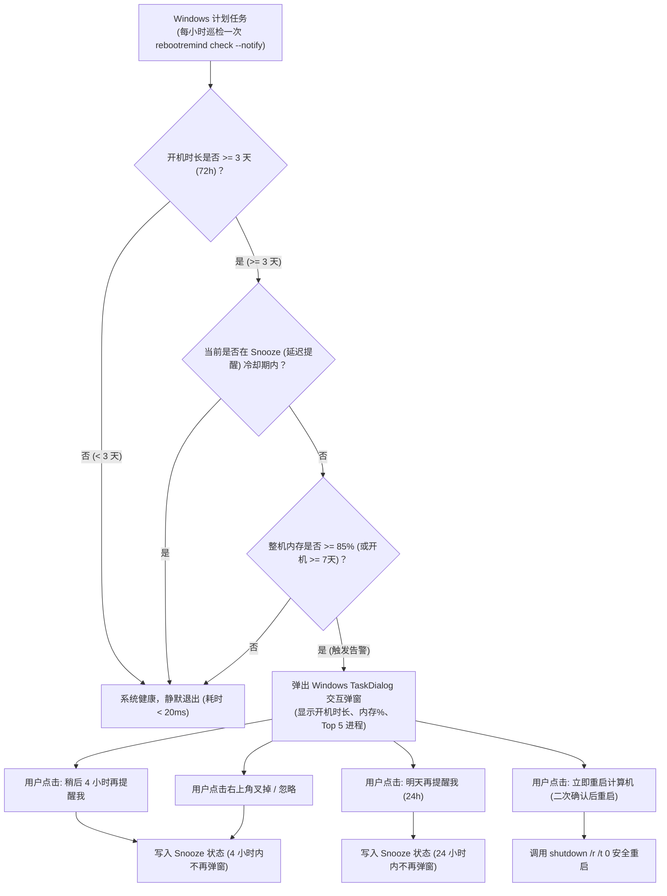

# rebootremind 实现计划（修订版）：Windows 开机时长与内存健康巡检重启提醒工具

## 1. 目标与背景分析（根据用户反馈调整）

### 1.1 核心痛点与机理修正
- **用户核心痛点**：长期不重启时，同样的软件组合内存占用从正常的 70%~80% 慢性膨胀至 90%+；重启能彻底清空内核驱动非分页池（Non-paged pool）与 V8 堆碎片。
- **误报边界辨析（针对用户质疑）**：
  - 如果刚开机不久内存达到 90%，是因为用户正在开大项目、虚拟机或重度软件（真实业务高负载），此时提示重启属于**误报打扰**。
  - **核心判定铁律**：必须以**“开机时间过长（如 ≥ 3 天）”作为硬性前置条件**！只有当“已开机 ≥ 3 天”**且**“内存 ≥ 85%”时，才确诊为“系统慢性泄漏与碎片化累积”，方触发提醒。
  - 极端时长兜底：若开机已达 7 天（168 小时），无论内存多少，也可进行温和的阶段性保养建议。

### 1.2 提醒交互形态选型：Windows 原生 TaskDialog 弹窗（替代易漏掉的 Toast）
- **为什么不用 Windows Toast 通知？**
  - Toast 通知在 Windows 10/11 上默认仅停留 5~7 秒便自动收进通知中心，极易被忽略；
- **为什么选用 Windows 原生 TaskDialog 弹窗？**
  - **强制可见、不点不消失**：弹窗居中/置顶显示，用户即使走开，回来看屏幕也能第一眼看到；
  - **Command Link 现代化系统级大按钮**：原生支持 Windows 系统诊断风格的大指令按钮，直观大方；
  - **零第三方 GUI 依赖**：纯 Win32 API（`comctl32.dll` 中的 `TaskDialogIndirect`），纳秒级唤起，零外部重型依赖；
  - **折叠展示 Top 5 内存大户**：支持通过“展开详细信息”原生控件查看哪些进程吃掉了内存。

---

## 2. 交互与防打扰机制（Snooze 延迟提醒）



### 2.1 弹窗文案与按钮设计
- **标题**：`系统维护提示 - rebootremind`
- **主指令（Main Instruction）**：`计算机已连续运行 3 天 14 小时，内存占用达 88%`
- **副文本（Content）**：
  `检测到系统长期未重启，内核缓冲池与软件堆内存存在碎片化累积。建议保存当前工作并重启计算机以恢复最佳性能。`
- **可展开详细信息（Expanded Information）**：
  当前内存大户：
  - `chrome.exe`：3,820 MB (16.2%)
  - `zed.exe`：1,940 MB (8.2%)
  - `wechat.exe`：980 MB (4.1%)
  - `feishu.exe`：850 MB (3.6%)
- **操作按钮（Command Links）**：
  1. `[4 小时后再提醒我] (推荐)` - 稍后空闲时再处理
  2. `[明天再提醒我]` - 今天不再提示
  3. `[立即重启系统]` - 弹出确认并安全重启

---

## 3. 核心架构与模块职责

遵循《CLI 工具开发标准》（Service 核心驱动 + 多壳解耦 + `--json`/`--schema` 标配）：

```text
go_projects/rebootremind/
├── .gitignore
├── AGENTS.md -> ../../AGENTS.md
├── CLAUDE.md -> ../../CLAUDE.md
├── README.md
├── go.mod
├── go.sum
├── cmd/
│   └── rebootremind/
│       ├── main.go               # CLI 入口与子命令分发
│       ├── icon.ico              # 默认地鼠图标
│       └── rsrc_windows_amd64.syso # rsrc 资源文件
├── internal/
│   ├── model/
│   │   ├── types.go              # 数据模型、内存状态、评估结果、JSON Envelope
│   │   └── schema.go             # 静态 JSON Schema 契约
│   ├── sysinfo/
│   │   ├── memory_windows.go     # GlobalMemoryStatusEx 采集内存
│   │   ├── uptime_windows.go     # GetTickCount64 采集开机运行时间
│   │   └── process_windows.go    # PSAPI 枚举进程 WorkingSet，按进程名聚合 Top N
│   ├── service/
│   │   ├── evaluator.go          # 核心业务：开机前置规则、内存水位、健康等级
│   │   └── state.go              # Snooze 延迟提醒状态管理与持久化
│   ├── ui/
│   │   └── dialog_windows.go     # Windows 原生 TaskDialog 交互弹窗
│   ├── scheduler/
│   │   └── task_windows.go       # Windows schtasks 计划任务一键安装/卸载
│   └── config/
│       └── config.go             # 数据目录隔离 (%APPDATA%\language_projects\rebootremind\<dev|prod>)
└── scripts/
    └── build.py                  # PEP 723 单文件构建脚本 (dev/release 自动隔离)
```

---

## 4. 实施计划步骤

### 阶段 1：项目基础设施与契约定义
1. 在 `go_projects/rebootremind` 初始化 `go.mod`；
2. 建立软链 `AGENTS.md` 与 `CLAUDE.md`；
3. 复制地鼠图标并使用 `rsrc` 生成 `rsrc_windows_amd64.syso`；
4. 编写 `internal/model`（数据模型、JSON Envelope、静态 Schema 结构）。

### 阶段 2：底层数据采集与业务核心
1. 编写 `internal/sysinfo`：
   - `GlobalMemoryStatusEx` 获取整机物理内存与百分比；
   - `GetTickCount64` 获取单调递增开机时间（纳秒级无误差）；
   - `process_windows.go` 枚举进程并按进程名汇总聚合出 Top 5 内存大户。
2. 编写 `internal/service/evaluator.go`：
   - 落实“开机时长作为硬前置条件”规则（默认 ≥ 72h 且 内存 ≥ 85%）；
   - 长期开机兜底规则（默认 ≥ 168h / 7天）；
   - 彻底废除任何无开机时长约束的纯内存报警，杜绝高负载误报。
3. 编写 `internal/service/state.go` 与 `internal/config/config.go`：
   - 记录 `snooze_until`，支持 4 小时 / 24 小时延迟提醒；
   - 严格落实 dev/prod 数据目录隔离（`%APPDATA%\language_projects\rebootremind`）。

### 阶段 3：Windows 原生 TaskDialog 交互弹窗
1. 编写 `internal/ui/dialog_windows.go`：
   - 调用 `comctl32.dll` 中的 `TaskDialogIndirect`；
   - 呈现主标题、开机天数、内存占用、展开的 Top 5 进程列表；
   - 绑定【4 小时后提醒】、【明天提醒】、【立即重启】等按钮回调。

### 阶段 4：计划任务集成与 CLI 编排
1. 编写 `internal/scheduler/task_windows.go`：
   - 封装 `schtasks`，支持 `rebootremind task install`（每 1 小时静默执行一次 `rebootremind check --notify`）和 `rebootremind task uninstall`；
2. 编写 `cmd/rebootremind/main.go`：
   - `status`：人读排版与 `--json` 格式输出；
   - `check`：巡检入口（支持 `--notify` 唤起弹窗、`--force` 强制唤起）；
   - `task`：计划任务安装/卸载/状态；
   - `config`：配置查看与修改；
   - `schema`：零 I/O 静态契约导出。
3. 编写 PEP 723 规范构建脚本 `scripts/build.py`。

### 阶段 5：验证与收尾
1. 单元测试与 mock 验证；
2. `rebootremind status` 与 `rebootremind status --json` 验证输出；
3. `rebootremind check --force --notify` 验证 TaskDialog 弹窗唤起与延迟按钮交互；
4. 构建 exe 并校验 PE 图标与资源；
5. 更新 README 与文档归档。

---

## 5. 验证计划

1. **状态查询验证**：
   ```powershell
   go run ./cmd/rebootremind status
   go run ./cmd/rebootremind status --json
   go run ./cmd/rebootremind schema
   ```
2. **弹窗与延迟提醒交互测试**：
   ```powershell
   # 强制触发弹窗，点击“4 小时后再提醒我”
   go run ./cmd/rebootremind check --force --notify
   # 再次运行，确认已处于 Snooze 状态，不再弹窗
   go run ./cmd/rebootremind check --notify
   ```
3. **构建与 PE 资源验证**：
   ```powershell
   uv run ./scripts/build.py --dev
   Add-Type -AssemblyName System.Drawing
   $i = [System.Drawing.Icon]::ExtractAssociatedIcon(".\bin\rebootremind-dev.exe")
   "$($i.Width)x$($i.Height)"  # 验证输出 32x32
   ```
