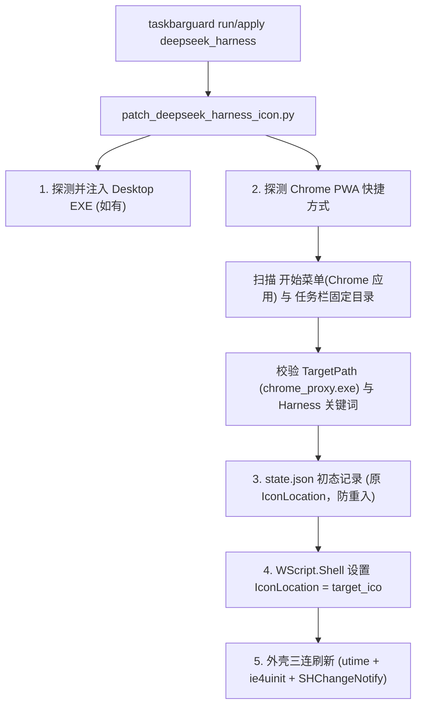

# Plan for: DeepSeek Harness Chrome PWA 快捷方式任务栏图标对齐

**问题陈述**：
用户通过 Chrome 将 DeepSeek Harness 安装为 Chrome 应用/PWA，生成了开始菜单快捷方式（`%APPDATA%\Microsoft\Windows\Start Menu\Programs\Chrome 应用\DeepSeek Harness.lnk`）并固定到任务栏（`%APPDATA%\Microsoft\Internet Explorer\Quick Launch\User Pinned\TaskBar\DeepSeek Harness.lnk`）。当前 `taskbarguard` 仅对桌面版 `DeepSeek Harness.exe` 进行 PE 图标注入，导致 Chrome 应用版在任务栏上的图标仍为默认低质感图标，出现视觉割裂。用户希望无需将其拆分为独立 App，而是直接与现有 `deepseek_harness` 模块对齐，实现快捷方式图标的统一守卫与恢复。

**需求确认**：
1. **全面联动 (1=a)**：同时更新开始菜单中的 `Chrome 应用\DeepSeek Harness.lnk` 与任务栏固定 `User Pinned\TaskBar\DeepSeek Harness.lnk`，确保任务栏视觉一致。
2. **自动探测一并对齐 (2=a)**：执行 `taskbarguard run/apply deepseek_harness` 时，既处理桌面版 EXE，又自动探测该 Chrome 快捷方式并换上同款质感图标；执行 `revert` 时同步安全还原。
3. **安全修改快捷方式属性 (3=a)**：通过 WScript.Shell 修改 `.lnk` 的 `IconLocation` 指向定制质感 ICO，初态锁定记录至 `state.json`，不污染 Chrome 内部缓存，还原时无损复原。

**背景现状**：
- 桌面版路径：`D:\Users\29580\AppData\Local\Programs\DeepSeek Harness\DeepSeek Harness.exe` 已存在。
- Chrome 快捷方式：
  - 开始菜单：`C:\Users\29580\AppData\Roaming\Microsoft\Windows\Start Menu\Programs\Chrome 应用\DeepSeek Harness.lnk`
  - 任务栏固定：`C:\Users\29580\AppData\Roaming\Microsoft\Internet Explorer\Quick Launch\User Pinned\TaskBar\DeepSeek Harness.lnk`
  - 目标程序：`chrome_proxy.exe`，参数含 `--app-id=pciiilodfhgablhkdjjhffjamkpjjnpf`。
- `scripts/wt/patch_wt_icon.py` 已有成熟的 WScript.Shell 快捷方式读写与 `state.json` 初态防覆写持久化范式。
- `taskbarguard` Go 层完全通过调度 `patch_deepseek_harness_icon.py` 执行，脚本内嵌更新后即可全局生效。

**方案架构**：

**任务分解**：
- [x] Task 1: 扩展 `patch_deepseek_harness_icon.py` 的快捷方式探测与安全修改能力
  - 文件：`go_projects/taskbarguard/scripts/deepseek_harness/patch_deepseek_harness_icon.py`
  - 实现：
    1. 实现 `detect_chrome_pwa_shortcuts()`：精准定位开始菜单「Chrome 应用」和任务栏固定目录中的 Harness 快捷方式（核验 `chrome_proxy.exe` 与 `app-id` / 名称）；
    2. 实现 `update_shortcut_icon()` 与初态持久化：写入 `state.json`（key: `chrome_pwa_harness_pristine_icons`，已有记录绝不二次覆盖），利用 WScript.Shell 修改 `IconLocation`；
    3. 在 `main()` 的更新主流程与 `args.restore` 分支中接入该逻辑，支持 `--restore` / `--revert` 时从 `state.json` 完美还原；
    4. 增强容错：若未安装 Desktop EXE 但存在 Chrome 快捷方式时正常处理快捷方式，不因缺少 EXE 阻断中断。
  - 验证：
    1. 运行 `uv run scripts/deepseek_harness/patch_deepseek_harness_icon.py --custom-icon scripts/deepseek_harness/custom_icons/8_underlit_chrome.ico` 检查输出；
    2. 检查开始菜单与任务栏 `.lnk` 的 `IconLocation` 是否变为指定 `.ico`；
    3. 运行 `--restore` 检查是否精准复原。
  - Demo：执行补丁后，任务栏与开始菜单中的 Chrome 版 DeepSeek Harness 图标瞬间变为与桌面版对齐的高质感图标。

- [x] Task 2: 验证 taskbarguard Go 层调度与内嵌资源同步
  - 文件：`go_projects/taskbarguard/internal/core/` 及 `scripts/`
  - 实现：
    1. 运行 `go test ./...` 确保既有单测不受影响；
    2. 执行 `uv run scripts/build.py` 重新生成 dev 产物（含内嵌资产刷新）；
    3. 执行 `bin/taskbarguard-cli-dev.exe run --style 8_underlit_chrome deepseek_harness` 测试端到端调度。
  - 验证：Go CLI 调度返回成功，PowerShell 探测任务栏固定 `.lnk` 属性生效，外壳广播无误。
  - Demo：通过 `taskbarguard-cli-dev.exe` 统一命令行与桌面工作台，一键批量守卫所有 Harness 图标。
