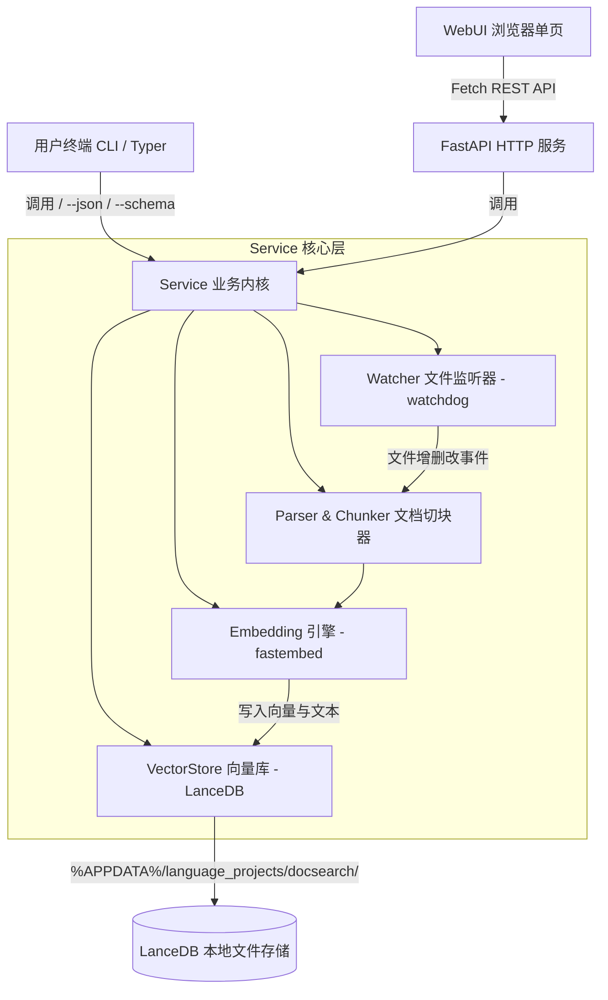

# Plan for: 本地文档与技能库语义检索系统 (docsearch)

**问题陈述**：
用户本地目录和 skill 目录存有大量文档，因关键词记忆模糊、文档命名各异，传统的精确 grep / 纯文件名搜索难以有效定位；同时文档在日常更新修改后，期望系统能自动重跑建立最新索引。需要一套轻量、完全离线、支持模糊自然语言记忆搜索的本地系统，并支持 CLI、JSON、Schema、HTTP API 以及内嵌 WebUI。

**需求确认**：
1. **项目定位与命名**：独立 Python 子项目，位于 `python_projects/docsearch`（无横杠/下划线拼合）。
2. **分层架构（对标 go projects CLI 标准）**：
   - **Service 层**：核心业务内核（Markdown 提取切块、FastEmbed 语义向量计算、LanceDB 嵌入式向量增量存储、Watchdog 文件系统自动监听与防抖重跑）。
   - **CLI 层（Typer）**：支持人读控制台高亮输出、`--json` 结构化输出、`--schema` 协议描述。提供 `watch`、`index`、`search`、`serve` 等命令。
   - **HTTP API 层（FastAPI）**：暴露 RESTful 搜索、状态监控与重建索引接口，底层直接调用 Service 层。
   - **WebUI 层**：纯原生静态 HTML/CSS/JavaScript，内嵌在 FastAPI 静态挂载中，提供极简单页检索框与文档高亮查看。
3. **配置驱动**：采用 `.toml` 配置文件（如 `config.toml`），配置监听目录清单（如 skills 目录、通用文档目录）、文件过滤规则、模型选型及分块参数。
4. **数据存储合规**：遵循父仓 `AGENTS.md` 约束，LanceDB 向量库与运行时缓存一律存储在 `%APPDATA%\language_projects\docsearch\`（缺省回退 `~/.language_projects/docsearch/`）。
5. **附录推荐软件**：在计划文末整理并附上成熟开源文档检索与知识库软件清单。

**背景现状**：
- 父仓根目录为 Monorepo 结构，`python_projects` 为独立 Git 模块。
- 根目录存在大量跨语言文档及全局技能目录（`D:\Users\language_projects\.agents\skills`、`C:\Users\29580\.gemini\config\skills` 等）。
- 机器具备现代 Python 3 环境与 `uv` 支持。

**方案架构**：

**任务分解**：
- [x] Task 1: 初始化 docsearch 项目骨架与配置文件规范
  - 文件：`python_projects/docsearch/pyproject.toml`, `python_projects/docsearch/src/docsearch/config.py`
  - 实现：配置 `pyproject.toml`（依赖 `typer`, `fastapi`, `uvicorn`, `lancedb`, `fastembed`, `watchdog` 等）；实现基于 `tomllib` 的配置读取与路径解析，默认存储路径严格遵循 `%APPDATA%\language_projects\docsearch\`。
  - 验证：运行 `uv run python -c "from docsearch.config import get_config; print(get_config())"` 正确解析并创建 APPDATA 路径。
  - Demo：成功生成默认 `config.toml` 模板。
- [x] Task 2: 实现核心 Service 层（分块解析、FastEmbed 向量化与 LanceDB 增量存取）
  - 文件：`python_projects/docsearch/src/docsearch/parser.py`, `python_projects/docsearch/src/docsearch/indexer.py`, `python_projects/docsearch/src/docsearch/service.py`
  - 实现：按 Markdown 标题或段落做语义 chunking；集成 `fastembed` 的中文轻量模型（默认 `BAAI/bge-small-zh-v1.5`）；使用 LanceDB 进行增量 upsert（先基于 filepath 清理历史 chunks 再写入最新 chunks）；实现混合或纯向量检索，返回命中文档路径、行号范围、相似度与上下文摘要。
  - 验证：运行测试，写入模拟 Markdown 文档，检索自然语言句子并正确断言返回文件路径。
  - Demo：调用 `service.search("并发锁排障")` 准确定位测试文档。
- [x] Task 3: 实现 Watchdog 增量文件热监听与自动防抖重跑机制
  - 文件：`python_projects/docsearch/src/docsearch/watcher.py`
  - 实现：基于 `watchdog.observers.Observer` 监听配置中声明的所有目录（递归）；针对 `.md` 变动（新建、修改、重命名、删除）引入 500ms~1s 防抖定时器，自动调用 Service 增量重跑对应单文件的向量重建；删除文件时自动级联剔除向量。
  - 验证：修改指定目录中的测试 `.md`，观察后台日志输出增量更新提示并验证新内容立即可查。
  - Demo：保存文档后 1 秒内，新内容即可被检索命中。
- [x] Task 4: 实现 CLI 入口（对标 go projects CLI 规范：--json、--schema、人读输出）
  - 文件：`python_projects/docsearch/src/docsearch/cli.py`
  - 实现：基于 `typer` 构建命令：
    - `docsearch search <query>`：默认人类可读高亮打印；`--json` 输出纯 JSON；`--schema` 输出该命令的入参出参 JSON Schema。
    - `docsearch index [--force]`：全量扫描配置目录并建库。
    - `docsearch watch`：启动常驻文件监听器。
    - `docsearch serve [--port 8000]`：启动 HTTP API 与 WebUI 服务。
  - 验证：`uv run docsearch search "测试" --schema` 成功输出有效 JSON Schema；`--json` 输出符合格式。
  - Demo：命令行执行模糊检索，终端呈现格式化文件路径与文本预览。
- [x] Task 5: 实现 FastAPI HTTP 服务与内嵌 WebUI 单页
  - 文件：`python_projects/docsearch/src/docsearch/server.py`, `python_projects/docsearch/src/docsearch/web/index.html`, `python_projects/docsearch/src/docsearch/web/app.js`, `python_projects/docsearch/src/docsearch/web/style.css`
  - 实现：FastAPI 提供 `/api/search`、`/api/status`、`/api/reindex`；挂载本地静态资源目录；WebUI 采用极简去 AI 味的现代深浅色自适应界面，支持快速搜索框、实时高亮、原文件本地快速跳转或段落阅读。
  - 验证：启动服务后访问 `http://localhost:8000`，测试页面检索与返回交互。
  - Demo：浏览器打开搜索框输入“模糊自然语言问题”，即时列出相关文档片段与文件名。

---

## 附录：推荐的成熟开源文档检索与知识库软件

如果你在未来希望直接选用成型软件或作为生产级备选方案，推荐以下几款优秀开源项目：

| 开源项目 | 核心定位与技术栈 | 目录变动监听能力 | 适用场景与亮点 |
| :--- | :--- | :--- | :--- |
| **[Khoj](https://github.com/khoj-ai/khoj)** | **最完善的个人离线第二大脑** Python / FastAPI + Local Embeddings + Local LLM | **原生支持目录热监视** 后台自动扫描并在文件增删改时自动更新向量 | 具备桌面端、Web端、Obsidian 插件与 Emacs 插件。支持 Markdown、PDF、Org-mode，支持离线自然语言搜索和直接对话。 |
| **[AnythingLLM](https://github.com/Mintplex-Labs/anything-llm)** | **一站式桌面知识库与工作区 RAG** Node / LanceDB / Chromium 桌面端 | **支持 Local Folder Sync** 可配置定时或按需同步本地文件夹 | 桌面一键安装，内置向量数据库与轻量嵌入模型，适合希望完全不用命令行、兼顾文档检索与完整对话的用户。 |
| **[qmd](https://github.com/tobi/qmd)** | **极简高速本地 Markdown 搜索引擎** Node / SQLite-vec / 专用轻量模型 | **增量 mtime 追踪** 结合 Obsidian 插件或后台进程增量嵌入 | 专为 Markdown 打造，混合检索（向量 + BM25 关键词），模型体积仅约 300MB，检索极快。 |
| **[Smart Connections](https://github.com/brianpetro/obsidian-smart-connections)** | **Obsidian 专属语义检索插件** 嵌入式 ONNX / BGE 模型 | **深度绑定 Obsidian 内部文件系统** 文件保存时实时计算嵌入向量 | 适合所有文档均在 Obsidian 中管理的用户，无缝在笔记侧边栏展示语义最相关的历史笔记。 |
| **[MCP-Markdown-RAG](https://github.com/Zackriya-Solutions/MCP-Markdown-RAG)** | **面向 Agent 的本地 Markdown MCP 服务** Python / MCP 协议 / 增量同步日志 | **追踪日志（Tracking Log）增量更新** 自动裁剪删除内容，仅更新修改文件 | 适合配合 Cursor、Claude Code、Antigravity 等智能体，随时将本地知识库挂载为智能体的 Tool。 |
