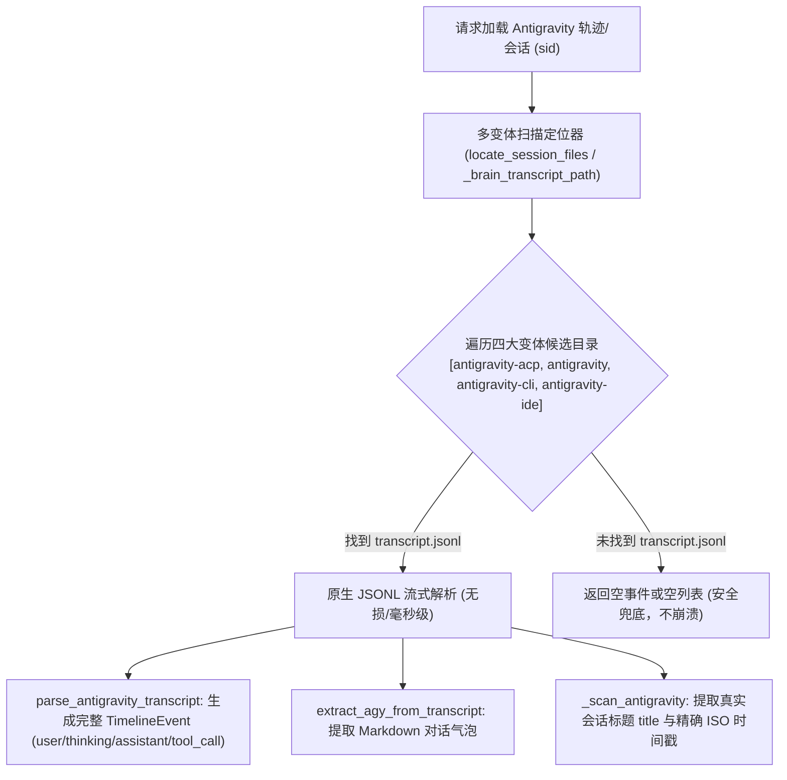

# Plan for: Antigravity 多变体 Transcript 优先轨迹与正文提取（彻底移除 Protobuf 解包）

**问题陈述**：
当前 `python_projects/zedhub` 在处理 Antigravity 会话时，维护了大量脆弱且无公开 schema 的手写 Protobuf 解包与 wire-format 递归代码（`_pb_varint`, `_pb_strings`, `_agy_step_events`, `_decode_varint`, `_parse_proto_fields` 等），不仅容易出现字段截断、格式丢失和性能开销，且在遇到新版 IDE/ACP 字段变更时极易失效。同时在多变体路径支持上，硬编码单一路径导致 `antigravity-acp` 等实例无法命中明文日志。需要将明文 `transcript.jsonl` 作为唯一正文与轨迹数据源，彻底删除两处手写的 Protobuf 解包代码，精简架构。

**需求确认**：
1. **全面覆盖实例**（用户决策 1=a）：统一检索并支持 `antigravity`（桌面版）、`antigravity-acp`（Zed 插件）、`antigravity-cli`、`antigravity-ide` 四大目录的 `brain/<sid>/.system_generated/logs/transcript.jsonl`。
2. **双管齐下改造**（用户决策 2=a）：同时改造 `trajectory.py`（时间线与完整轨迹）和 `agy_extractor.py`（会话正文气泡），统一为纯 Transcript 解析。
3. **彻底删除 Protobuf 解包**（最新指令）：直接将 `trajectory.py` 与 `agy_extractor.py` 中的手写 Protobuf 解包、varint 解析、启发式 tag 提取等冗余逻辑彻底清理删除，不再保留死代码。
4. **文档落盘规范**：遵循父仓 `AGENTS.md` 镜像规范，本计划落盘至 `docs/projects/python_projects/zedhub/plans/01-antigravity-transcript-priority.md`。

**背景现状**：
1. 本地四大实例在 `~/.gemini/` 下均维护一致的明文日志结构：`~/.gemini/<variant>/brain/<id>/.system_generated/logs/transcript.jsonl`，包含结构化的 `USER_INPUT`、`PLANNER_RESPONSE`（含 `thinking`、`content`、`tool_calls`）。
2. `agy_extractor.py` 中有近 170 行手写 wire-format protobuf 递归解析器代码，且其测试用例依赖构造 protobuf 二进制。
3. `trajectory.py` 中有约 150 行底层 protobuf varint/strings 及启发式 tag 映射代码。
4. 清理这部分代码后，整个 Antigravity 模块将与 Claude Code / Codex 一样，转为基于标准 JSON Lines 的极简优雅流式解析器。

**方案架构**：

**任务分解**：

- [x] Task 1: 扩展多变体路径定位与会话元数据扫描
  - 文件：`python_projects/zedhub/src/zedhub/core/agent_paths.py`、`python_projects/zedhub/src/zedhub/core/agent_sessions.py`
  - 实现：
    1. 在 `agent_paths.py` 中定义 Antigravity 四大目录候选列表 `("antigravity-acp", "antigravity", "antigravity-cli", "antigravity-ide")`。
    2. 改造 `locate_session_files("antigravity", ...)`：优先定位各实例下的 `brain/<sid>/.system_generated/logs/transcript.jsonl`。
    3. 改造 `agent_sessions.py` 的 `_scan_antigravity`：跨四大实例目录扫描，若存在 `transcript.jsonl`，调用 `_extract_user_request` 提取真实的会话 `title` 与准确 ISO 时间戳。
  - 验证：运行 `& "D:\Users\language_projects\python_projects\zedhub\.venv\Scripts\python.exe" -m pytest "D:\Users\language_projects\python_projects\zedhub\tests\test_search_scope.py"` 确保会话扫描与元数据解析通过。
  - Demo：在 ZedHub 会话列表里，Antigravity 会话能显示出具体的第一句提示词标题，而不是空白。

- [x] Task 2: 改造正文提取器并彻底删除 Protobuf 解包代码
  - 文件：`python_projects/zedhub/src/zedhub/core/agy_extractor.py`
  - 实现：
    1. 重构 `_brain_transcript_path`，按优先级依次在四大变体目录查找：`antigravity-acp` -> `antigravity` -> `antigravity-cli` -> `antigravity-ide`。
    2. 彻底删除 `_decode_varint`, `_parse_proto_fields`, `_extract_longest_text`, `_extract_user_text_from_proto`, `_extract_assistant_text_from_proto`, `extract_agy_from_sqlite` 等全部手写 Protobuf 解码函数。
    3. 改造 `extract_agy_messages`：直接基于 `_brain_transcript_path` 调用 `extract_agy_from_transcript`，未命中时安全返回空列表。
  - 验证：运行 `& "D:\Users\language_projects\python_projects\zedhub\.venv\Scripts\python.exe" -m pytest "D:\Users\language_projects\python_projects\zedhub\tests\test_agy_extractor.py"`。
  - Demo：代码体积减少约 200 行，正文提取完全依赖原生 JSON，速度提升且不再有任何二进制依赖。

- [x] Task 3: 改造多源轨迹解析支持 Transcript 并删除 Protobuf 代码
  - 文件：`python_projects/zedhub/src/zedhub/core/trajectory.py`
  - 实现：
    1. 新增 `parse_antigravity_transcript(path: Path, *, limit: int = 2000) -> list[TimelineEvent]`：
       - `USER_INPUT`：提取 `role="user"`，正文通过 `_extract_user_request` 清洗；
       - `PLANNER_RESPONSE`：解析 `thinking`（`role="thinking"`）、`tool_calls`（`role="tool_call"` 提取工具名与参数 JSON）、正文回复（`role="assistant"`）；
       - 包含 `created_at` 映射为 `ts`。
    2. 彻底删除 `_pb_varint`, `_pb_strings`, `_agy_step_events`, `_try_decode_blob`, `parse_antigravity_db` 等底层 Protobuf 函数。
    3. 改造 `load_trajectory`：当 `source in ("antigravity", "antigravity-desktop")` 时，定位并调用 `parse_antigravity_transcript`。
  - 验证：运行 `& "D:\Users\language_projects\python_projects\zedhub\.venv\Scripts\python.exe" -m pytest "D:\Users\language_projects\python_projects\zedhub\tests\test_trajectory.py"`。
  - Demo：在 ZedHub WebUI 或 trajectory API 中查看 Antigravity 轨迹时，展示完整的思考过程与清晰的工具调用树。

- [x] Task 4: 更新单元测试套件与全套验证
  - 文件：`python_projects/zedhub/tests/test_agy_extractor.py`、`python_projects/zedhub/tests/test_trajectory.py`
  - 实现：
    1. 清理 `test_agy_extractor.py` 中对 Protobuf Varint/SQLite 的废弃测试，更新为四大变体目录探测测试与真实 JSONL 场景测试。
    2. 在 `test_trajectory.py` 中增加对 `parse_antigravity_transcript` 与 `load_trajectory(source="antigravity")` 的回归测试用例。
    3. 执行完整测试套件，确认 100% 通过且无回归。
  - 验证：`& "D:\Users\language_projects\python_projects\zedhub\.venv\Scripts\python.exe" -m pytest "D:\Users\language_projects\python_projects\zedhub\tests"` 全部通过。
  - Demo：全套 pytest 测试一次性通过，输出 `collected XX items, XX passed`。
