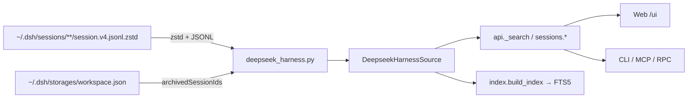

# 设计文档

## Overview

在 zedhub 现有 `AgentSource` 协议下新增一个**结构化只读源** `deepseek-harness`：
直接扫描 `~/.dsh/sessions` 下的 zstd JSONL 事件流，投影为统一的 `Session` /
`Message`，从而自动复用列表、详情、正文、元数据检索与 FTS5 正文索引五条既有通路。
不进入 Zed 索引，不实现 link/export/trajectory。

## Context

zedhub 的数据源分两层：

- **Zed 索引**（`sidebar_threads`）是检索主表，代表「Zed 里看得见的会话」；
- **AgentSource** 提供会话与正文，当前注册 `opencode`（结构化）与
  `claude-code` / `codex` / `antigravity` / `pi`（文件级）。

`api.py::_search` 已遍历 `session_source_ids()` 聚合所有 `sessions` 能力的源，并作为
`external_session` 投影；`index.py::build_index` 同样遍历该集合。因此只要新增一个
声明 `sessions` + `content` 的源，检索与全文索引**无需修改**。

DSH 与 Zed 完全无关：本机 Zed 的 `sidebar_threads.agent_id` 只有
`opencode` / `antigravity-acp` / `claude-acp` / `codex-acp` / `pi-acp` 等，没有 DSH。
因此 DSH 会话只以外部会话形态出现，`zed_thread_id` 始终为 `None`。

## Goals and Non-Goals

- Goals：DSH 会话可列出、查看正文、被元数据检索与全文检索命中；只读、零写入。
- Non-Goals：`sessions link`、`archive export/import`、trajectory、写操作、Zed 侧集成。

## Detailed Design

### 数据解析层

- `CREATED` `src/zedhub/core/deepseek_harness.py`
  - **Purpose**：DSH zstd JSONL 的读取、元数据短路扫描、正文提取、归档集合读取。
  - **Changes**：
    - 常量：`DSH_SESSION_FILENAME = "session.v4.jsonl.zstd"`、
      `HEAD_LINE_LIMIT = 400`、`TITLE_MAX = 80`、`DSH_SOURCE_ID = "deepseek-harness"`。
    - `dsh_root(home: Path | None = None) -> Path`：`home` 显式传入时返回
      `home/".dsh"`（测试隔离，忽略环境变量）；否则 `DSH_DATA` 优先，回退
      `Path.home()/".dsh"`。放在 `agent_paths.py` 作为路径 SSOT，本模块导入使用。
    - `iter_session_files(root: Path) -> Iterator[Path]`：`root/"sessions"` 下
      `rglob(DSH_SESSION_FILENAME)`，排序后返回；目录不存在返回空。
    - `load_archived_ids(root: Path) -> set[str]`：读
      `storages/workspace.json` 的 `global.archivedSessionIds`；任何
      `OSError`/`JSONDecodeError`/结构不符 → 返回空集合（不抛）。
    - `scan_session(path: Path) -> DshSessionMeta`：用
      `zstandard.ZstdDecompressor().stream_reader()` + `io.TextIOWrapper` 逐行解析，
      收集：
      - 首行 `type == "session"`：`id`、`createdAt`（ms）、`cwd`；
      - `type == "session/title"`：`data.title`，**拿到即停止**；
      - `type == "user/message"`：记录首条纯文本作为标题兜底；
      - 到达 `HEAD_LINE_LIMIT` 行停止；
      - `updated_at` = 文件 `st_mtime`（UTC）；`archived` 由调用方注入。
    - `DshSessionMeta`（frozen dataclass）：`session_id` / `title` / `directory` /
      `created_at` / `updated_at` / `path`。
    - `extract_dsh_messages(path: Path) -> list[Message]`：完整遍历事件流：
      - `user/message` → `data.content[]` 过滤 `type == "text"`；
      - `assistant/message` → `data.message.content[]` 过滤 `type == "text"`
        （丢弃 `reasoning`）；
      - `id` 用 `dsh_msg_{n}` / `dsh_prt_{n}_0`；`created_at` 由事件 `time`（ms）转换；
      - 空文本跳过；整文件损坏时返回已解析部分。
    - `title_fallbacks(path, root)`：读
      `storages/session_projcache/sessions/<session_dir_name>.json` 的
      `record.rows.title.val`；失败返回 `None`。
  - **Complexity**：Medium

### 源适配器

- `CREATED` `src/zedhub/core/sources/deepseek_source.py`
  - **Purpose**：把解析层投影为 `AgentSource`。
  - **Changes**：
    - `class DeepseekHarnessSource(AgentSource)`：
      - `source_id = "deepseek-harness"`；
      - `info`：`display_name="DeepSeek Harness"`；`availability` 依
        `dsh_root().is_dir()`；`capabilities=[SESSIONS, CONTENT, DISCOVERY]`；
        不可用时 `note="数据根目录不存在: <root>"`。
      - 进程内元数据缓存：`dict[Path, tuple[int, int, DshSessionMeta]]`，键为文件
        路径，值含 `(mtime_ns, size, meta)`；命中且 stat 未变则复用。归档集合按
        `workspace.json` 的 `(mtime_ns, size)` 缓存。无锁（GIL 下最坏重复计算）。
      - `list_sessions(request)`：遍历文件 → `scan_session` → 注入 `archived` →
        按 `project`（`directory` 子串 casefold）、`agent`（精确）、`archived`
        三态过滤 → 按 `updated_at` 倒序 → `limit`。
      - `get_session(external_id)`：在 `list_sessions(archived="all")` 中按
        `external_id` 匹配；未命中抛 `NotFoundError`（不猜测）。
      - `get_content(external_id)`：`get_session` + `extract_dsh_messages(path)`。
      - 单文件异常：捕获 `Exception`，记录 `logging.getLogger(__name__).warning`，
        跳过该会话（list 中不可见；get_content 继续尝试）。
  - **Complexity**：Medium

### 注册与路径

- `UPDATED` `src/zedhub/core/sources/__init__.py`
  - 注册 `SOURCES["deepseek-harness"] = DeepseekHarnessSource()`；导出类。
- `UPDATED` `src/zedhub/core/sources/base.py`
  - `SOURCE_ALIASES["dsh"] = "deepseek-harness"`。
- `UPDATED` `src/zedhub/core/agent_paths.py`
  - `dsh_root()` 实现；
  - `_DATA_ROOT_NAMES["deepseek-harness"] = ".dsh"`，并在 `agent_data_root` 中
    对 `deepseek-harness` 委托 `dsh_root(home)`；
  - **不**加入 `FILE_SOURCES`（该元组驱动 archive v2 与 link），**不**加入
    `SOURCE_AGENT_IDS`，**不**扩展 `locate_session_files`（避免 trajectory 半支持）。

### Web 检索页

- `UPDATED` `src/zedhub/webui/app.js`
  - 新增 `SOURCE_LABELS` 映射（含 `deepseek-harness: "DeepSeek Harness"`）；
  - `openHit` 类型行改为 `hitKindLabel(hit)`：
    `zed_thread` → `Zed 索引线程`；其他 → `${label} 会话（未被 Zed 管理）`；
  - `agentSource` 推断追加 `deepseek-harness`（含 `aid` 含 `deepseek` 的兜底）；
  - `hasContentSupport` 数组加入 `"deepseek-harness"`；
  - 「查看轨迹」按钮仅在 `agentSource !== "deepseek-harness"` 时渲染。
  - agent 下拉无需改动：`/search?scope=all` 的 `external` 统计会自动带出。

### 契约与文档

- `UPDATED` `src/zedhub/contract.py`：`source` 字段注释与 `sessions`/`trajectory`
  摘要补 `deepseek-harness`（trajectory 明确标注不支持）。
- `UPDATED` `src/zedhub/cli.py`：`sessions list/show/content` 的 `--source` help。
- `UPDATED` `pyproject.toml`：`zstandard>=0.22` 移入 `[project].dependencies`
  （从 `dev` 组移除），随后 `uv lock`。
- `UPDATED` `README.md`：数据源边界段落增加 DSH 只读源说明与命令示例。
- `UPDATED` `docs/projects/python_projects/zedhub/zedhub 对接协议.md`：数据源清单。

### Module Collaboration and Data Flow

1. `api._search` → `session_source_ids()`（动态）→ `get_source("deepseek-harness")`
   → `list_sessions(archived="all")` → 与 Zed threads 合并，DSH 全部是
   `external_session`；
2. `api._sessions_list/show/content` → 同一实例 → `get_session` / `get_content`；
3. `index.build_index` → `list_sessions` → `get_content` → FTS5 行；
4. `sources` 端点直接读 `info`，常量成本。

缓存只存在于源实例内，daemon 重启即失效；不产生磁盘缓存。

### Acceptance Criteria Mapping

| AC ID | Design Component |
|---|---|
| AC-1 | `DeepseekHarnessSource.info` + `sources/__init__.py` 注册 |
| AC-2 | `info.availability` + `list_sessions` 空目录短路 |
| AC-3 | `scan_session` 短路扫描 + 元数据缓存 |
| AC-4 | `extract_dsh_messages` |
| AC-5 | `session_source_ids()` 动态聚合（`api._search` 既有逻辑） |
| AC-6 | `index.build_index` 遍历 `session_source_ids()`（既有逻辑） |
| AC-7 | `webui/app.js` 文案/正文/轨迹条件 |
| AC-8 | 不加入 `FILE_SOURCES` / `SOURCE_AGENT_IDS`，既有 `source_not_supported` |

## Design Review Notes

零上下文自审发现（修复后复核，无遗留 HIGH/MEDIUM）：

- **[HIGH → 已修复] 性能假设错误**：最初设想「读前 64KB 即得标题」；实测标题事件
  可能位于超大 `user/message` 之后，固定字节截断不可靠。改为逐行解析并在
  `session/title` 处短路（251 会话 0.13s），不再依赖字节窗口。
- **[MEDIUM → 已修复] 环境变量与测试隔离冲突**：`DSH_DATA` 若在测试中生效会覆盖
  `tmp_path`。约定 `dsh_root(home)` 显式传入 `home` 时忽略环境变量，测试统一走显式
  `home` 或 `monkeypatch.setenv`。
- **[MEDIUM → 已修复] 归档文件损坏风险**：`workspace.json` 结构属 DSH 内部格式，
  可能缺失/变更；按「解析失败即空集合、全部未归档」降级，不阻断源。
- **[MEDIUM → 已修复] `locate_session_files` 的连带影响**：若把 DSH 加入该函数，
  `_trajectory` 会进入「有文件但无解析分支」的半支持状态并返回空轨迹。改为不加入，
  轨迹请求保持明确 `source_not_supported`，UI 隐藏按钮。
- **[MEDIUM → 已修复] 默认可见性**：`SearchRequest.scope` 默认 `zed`，DSH 默认不出现在
  搜索结果。这是既有语义（外部会话默认折叠），不修改默认值；README 与 UI 下拉
  「全部外部发现会话」提供入口，避免与 Zed 视图重复。
- **[NIT] 已处理**：`updated_at` 用文件 mtime，避免为取末事件时间而全量解压。
- **[NIT] 已处理**：标题兜底顺序 title → 首条 user 文本 → projcache → id 前缀。

已验证假设：

- `zstandard` 解压速度实测约 200MB/s，全量 251 文件 1.46s；
- `session_source_ids()` 与 `index.build_index` 确为动态遍历，无需改动；
- `sidebar_threads.agent_id` 无 DSH 记录，确认不进 Zed 索引。

未验证或错误假设：无遗留。
