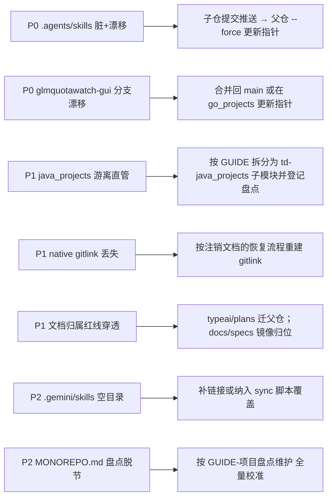

# language_projects 仓库架构调研报告

> **调研方式**：由 antigravity CLI（agy 1.4.0，`--sandbox --mode plan` 严格只读）执行深度调研，DSH 会话对关键断言做独立命令级复核。
> **调研日期**：2026-10-17　**对象**：`D:\Users\language_projects`
> **证据约定**：结论均标注相对路径；凡规则文件声称与文件系统事实不一致者单独点出；未能实测者标注「未验证」。

---

## 一、结论摘要（TL;DR）

本仓库是一套 **「多语言子仓联邦 + 父仓集中治理」** 的工程总仓（Monorepo of Monorepos），三条设计主轴：

1. **运行环境物理隔离**：各语言子仓为独立 Git 仓库（`.gitmodules` 中 `ignore = all`），互不干扰依赖、分支与 IDE 索引；
2. **文档与运维设施全局集中**：全部文档收归父仓 `docs/`，运维脚本收归父仓 `.scripts/`，子仓内禁止自建文档体系；
3. **AI Agent 认知基础设施一等公民**：`GLOBAL.md` / `AGENTS.md` 分层规则 + `.agents/skills` 技能真身 + AOCI 仓库级认知索引，构成长会话可复用的上下文底座。

实测偏离（均已定位到具体路径）：

| 级别 | 偏离 | 事实 |
| :--- | :--- | :--- |
| P0 | `.agents/skills` 亚健康 | 父仓索引记 `7907c46`，实际 HEAD `fd07205`（ahead 1），且子仓内有**大量未提交的重命名/删除/修改**；因 `ignore = all`，父仓 `git status` 完全显示不出来 |
| P0 | 嵌套子模块分支漂移 | `go_projects/glmquotawatch-gui` 处于 `feat/fyne-rewrite`（非声明分支 `main`），`git submodule status` 带 `+` |
| P1 | `java_projects` 游离于子模块契约 | 41 个源码文件以 `100644` 普通文件直接由父仓跟踪；未出现在 `.gitmodules`、`AGENTS.md`、`README.md`、`MONOREPO.md`、`docs/projects/` |
| P1 | `native_projects` 声明-索引不一致 | `.gitmodules` 有条目，父仓索引**无 gitlink**、磁盘无目录（**有意注销**，但 gitlink 曾被静默删除） |

**总体判断**：架构设计意图清晰、执行度很高（`%APPDATA%` 统一落盘 34 个项目目录、14 个 PEP 723 运维脚本、四个子仓规则指针齐备），偏离集中在**子模块指针治理**与**盘点文档同步**两处，属可收敛的运维债，非架构性缺陷。

---

## 二、总体架构

### 2.1 顶层布局

```text
D:\Users\language_projects/
├── .agents/          # AI Agent 资产（skills 为子模块真身）
├── .aoci/            # AOCI 认知索引元数据（baseline 107KB / ledger 238KB）
├── .archived/projects/<lang>/   # 归档项目（go 17 / python 10 / rust 1）
├── .claude .codex .cursor .dsh .gemini .opencode .pi .zed .vscode   # 各 Agent / 编辑器配置
├── .scripts/         # 父仓运维工具链（14 个 PEP 723 单文件脚本）
├── .tests/ .thirdparty/ .local/ .drafts/ .mkdocs-site/  # 测试占位 / 外部参考 / 本机私有 / 草稿 / 站点产物
├── docs/             # 全仓唯一文档库（MkDocs 源目录）
├── go_projects/      # [Submodule] 13 个活跃项目
├── java_projects/    # [非 Submodule / 父仓直管] Spring Boot 项目
├── python_projects/  # [Submodule] 13 个活跃项目
├── rust_projects/    # [Submodule] 2 个活跃项目
├── typescript_projects/  # [Submodule] 11 个活跃项目
├── AGENTS.md GLOBAL.md CLAUDE.md   # 规则三层：仓库契约 / 跨 Agent 基线 / Claude 指针
├── README.md MONOREPO.md NOTES.md THIRDPARTY.md
├── mkdocs.yml opencode.json plans_status.sql
└── aoci.txt aoci.code.txt aoci.meta.txt
```

### 2.2 父仓资产职责

| 资产 | 职责 |
| :--- | :--- |
| `docs/` | 全仓唯一文档中枢，驱动 MkDocs 站点（`mkdocs.yml`）；子仓禁止自建文档 |
| `.archived/projects/<lang>/` | 停更项目集中区，按语言分层，保留完整源码与历史 |
| `.scripts/` | 运维工具中心，统一 PEP 723 + uv 单文件，禁止 ps1/bat 与 `pyproject.toml` |
| `.agents/skills` | 技能库真身（独立仓库子模块），经 junction 暴露给各 Agent |
| `aoci*.txt` / `.aoci/` | 跨会话复用的仓库级结构化认知索引 |
| `.thirdparty/` + `THIRDPARTY.md` | 外部参考仓库克隆区（不入库），脚本可恢复 |
| `.zed/` | 全仓编辑器统一配置（LSP 白名单、扩展清单、任务面板） |

---

## 三、子模块体系三方一致性（实测）

核验维度：`.gitmodules` 声明 → `git ls-files -s`（索引 gitlink）→ `git submodule status` → 磁盘目录。

| 模块 | 声明 | 索引 | `submodule status` | 磁盘 | 判定 |
| :--- | :--- | :--- | :--- | :--- | :--- |
| `.agents/skills` | ✅ | `160000 7907c46` | `+fd07205 (heads/main)` | 存在 | **指针漂移 + 工作区脏**（ahead 1，大量未提交改动） |
| `go_projects` | ✅ | `160000 2b61554` | ` 2b61554` | 存在 | 一致（main / 0-0 / 干净） |
| `python_projects` | ✅ | `160000 3874fb7` | ` 3874fb7` | 存在 | 一致（main / 0-0 / 干净） |
| `rust_projects` | ✅ | `160000 a34b332` | ` a34b332` | 存在 | 一致（已恢复初始化） |
| `typescript_projects` | ✅ | `160000 0aed6ee` | ` 0aed6ee` | 存在 | 一致（main / 0-0 / 干净） |
| `native_projects` | ✅ | **无** | **无输出** | 不存在 | **幽灵声明**：声明在，gitlink 已丢失 |
| `java_projects` | ❌ | **41 个 `100644`** | 无输出 | 存在 | **游离直管**：父仓直接跟踪业务源码 |

> ⚠️ **勘误提醒**：`git submodule status` 输出中的 `(typeai/v0.1.0-72-g2b61554)`、`(jtree/v0.3.0-11-g0aed6ee)` 是 **`git describe` 描述串**（最近 tag + 提交数），**不是分支名**。据此判定「分支漂移」会误报——`go_projects` 与 `typescript_projects` 实际都在 `main` 且与 `origin/main` 完全同步。

**嵌套子模块**（`go_projects/.gitmodules`）：

| 嵌套模块 | 分支 | 索引 vs 实际 | 判定 |
| :--- | :--- | :--- | :--- |
| `glmquotawatch-gui` | `feat/fyne-rewrite` | 索引 `v0.2.0-1-g1e7bbde` 带 `+` | **分支 + 指针漂移** |
| `nginx-ai-proxy` | `main` | `0f0a637` 一致 | 正常 |

---

## 四、边界契约「言行对照」

| 契约（来源） | 落地证据 | 执行情况 |
| :--- | :--- | :--- |
| 文档只在父仓，子仓禁 `docs/`/`plans/`/`specs/`（`AGENTS.md` §7） | — | **局部穿透**：`go_projects/typeai/plans/`、`python_projects/hucci-registration-use-case-layered/docs/` 违规入库；父仓根级 `docs/specs/01-web-archive-skill`、`02-nginx-ai-proxy`、`03-clictl-gui` 属子项目 spec 却未镜像到 `docs/projects/<lang>/<sub>/specs/` |
| 运行时数据只落 `%APPDATA%\language_projects\<项目>\`（`AGENTS.md` §4） | `%APPDATA%\language_projects\` 下 **34 个项目数据目录** | **执行良好**（实测存在，含 `zedhub`、`typeai`、`clictl`、`plansql` 等） |
| dev/prod 数据与产物隔离（`AGENTS.md` §5 go） | `%APPDATA%\language_projects\glmquotawatch-gui\` 下 `dev`/`prod`/`demo` | **已落地（抽样 1 例）**，未全量验证 |
| 提交范围隔离 + commit message 规范（`AGENTS.md` §3） | 父仓近 15 条：`docs(plans):`、`fix(submodules):`、`chore(aoci):`、`docs(specs):` | **符合规范**；提交历史被「更新 .agents/skills 子模块指针」高频占据，反应技能库迭代频次高 |
| 新增语言子仓须「独立子仓 + 规则指针」（`AGENTS.md` §8） | 四个子仓均有 `AGENTS.md` + `CLAUDE.md` 指针 | 四子仓**齐备**；`java_projects` 有指针文件却**不是子模块**，进程外于该规范 |

---

## 五、各语言子仓全景

| 子仓 | 项目数 | 定位（`AGENTS.md` / 子仓规则） | 活跃项目 |
| :--- | :--- | :--- | :--- |
| `go_projects` | 13 | CLI 为主，新工具默认配 MCP + `--json` + `schema`；非 CLI 服务端/GUI 属例外；统一 `build.py` + dev/release 隔离 + 地鼠图标 | agyquota、clictl、plansql、pythonlauncher、quickask、sourcecount、taskbarguard、typeai、zreadmanager、glmquotawatch-gui、typeai-gui、liteconf、nginx-ai-proxy |
| `python_projects` | 13 | Nuitka + 双蛇图标；学习实验性质项目多 | archery-mcp、douyinnotify、todonotify、zedagentstats、zedhub、django-lab、docsearch、douyin_downloader、llm-finetune-lab、sql-pg-sqlalchemy、tech_learning_room、hucci-registration-use-case-layered、standalone_scripts |
| `rust_projects` | 2 | Windows 系统底层 CLI（rustup stable-msvc + rsproxy 镜像） | minieverything、whoholds |
| `typescript_projects` | 11 | 不设 `pnpm-workspace.yaml` 与根 `package.json`，子项目间无 workspace 关联 | ai-philosophy-reel、cli-json-reel、django-lab-react、frontend-learning-guide、gemini-launcher、jtree、playwright-demo、taskmon、text-extractor、tooldeck、tooldeck-tauri |
| `java_projects` | 1 仓多模块 | **无规则文件定义其定位**（`AGENTS.md` 未收录） | career-starter-basics、career-payment-saas、career-agent-diagnose（Spring Boot 3 / Java 21，含父 `pom.xml`） |

**「一个子目录 = 一个项目」执行情况**：四语言子仓基本成立。已识别偏差：`python_projects/standalone_scripts`（集合型目录，非单项目）；`go_projects` 的 `glmquotawatch-gui` / `nginx-ai-proxy` 为嵌套子模块（层级例外，已由 `go_projects/.gitmodules` 显式声明）。

---

## 六、工程化基础设施

### 6.1 运维工具链（`.scripts/`，14 个 PEP 723 单文件）

抽查 `build_docs.py`、`init-submodules.py`、`sync-agent-rules.py`、`calc_crap.py` 头部，**全部带 `# /// script` 块**（`requires-python` + `dependencies`），符合规范。

| 脚本 | 职责 |
| :--- | :--- |
| `build_docs.py` / `gen_icon.py` / `gen_python_logo.py` | 文档站点构建；Go 地鼠图标 / Python 双蛇图标流水线 |
| `init-submodules.py` / `submodule-toggle.py` / `link-submodule-agents.py` | 子模块初始化与切分支；临时注销/恢复；Agent 规则链接 |
| `sync-agent-rules.py` | 跨 Agent（Codex/Claude/OpenCode/Pi/DSH/AGY）规则同步分发 |
| `install-mcp.py` / `install-aoci-mcp.py` / `install_tool.py` | MCP 与工具配置分发 |
| `restore-thirdparty.py` | `.thirdparty/` 外部参考仓恢复 |
| `check-agy-upstream.py` / `calc_crap.py` | agy 上游版本核查；CRAP 复杂度度量 |
| `lark_group_bridge.py` | 飞书群桥接 |

### 6.2 其他设施

- **构建契约**：Go 子仓统一 `build.py`（HEAD 命中 tag 且工作区干净才产 release，否则 `-dev`），与 `AGENTS.md` §5 一致；
- **CLI/MCP 标准**：`docs/projects/go_projects/CLI 工具开发标准.md` 存在，`plansql`、`sourcecount` 等项目已按「Service 核心 + `--json` + `schema`」多壳形态落地；
- **GUIDE 体系**：`docs/guides/` 11 份作业指导（含 `GUIDE-子项目拆分子模块.md`、`GUIDE-项目盘点维护.md`、`GUIDE-项目归档/恢复.md`），为架构变更提供了可执行 SOP。

---

## 七、Agent 与认知基础设施

1. **规则三层继承**：`GLOBAL.md`（跨 Agent 通用基线）→ `AGENTS.md`（本仓契约，硬上限 24000 字节供 agy 读取）→ `CLAUDE.md`（单行 `@AGENTS.md` 导入）；四个子仓根目录均有 `AGENTS.md` 指针 + `CLAUDE.md` 单行导入（`@../AGENTS.md`），实测齐备。
2. **技能真身与链接链**：`.agents/skills` 为子模块（真身）→ 家目录 `~/.agents/skills` 为 **Junction** 指向仓内 → 仓内 `.cursor/skills` 又为 Junction 指向 `~/.agents/skills`（**两级跳转**）。家目录误删只断链不丢数据，容灾设计成立。
3. **AOCI 认知索引**：`aoci.code.txt` 442 行（约 302 个条目）、`aoci.txt` 7 行、`aoci.meta.txt` 20 行；`.aoci/baseline.json` 107 KB、`.aoci/ledger.jsonl` 238 KB。规模适中，可支撑单次全景加载。

> ⚠️ **实测缺口**：`.gemini/skills` 是**空目录（0 条目、非链接）**。若 Antigravity/Gemini 端依赖该挂载点，则技能库对其不可见——SSOT 链此处断裂，建议核查 `sync-agent-rules.py` 是否覆盖该端。

---

## 八、风险与改进建议（按优先级）



### P0-1　`.agents/skills` 亚健康被 `ignore = all` 掩盖

- **事实**：父仓索引记 `7907c46`，实际 HEAD `fd07205`（相对 `origin/main` ahead 1）；子仓内 `git status` 显示**数十项重命名（`R`）、修改（`M`）、删除（`D`）与未跟踪目录 `kb-engineering-notes/scripts/`**，属知识库文件名规范化迁移的半成品状态。
- **危害**：父仓 `git status` 永远「干净」（`ignore = all` 屏蔽），漂移完全不可见；换机克隆总仓将拿不到这些变更；未提交的删除项一旦被误操作清理即真丢失。
- **建议**：在 `.agents/skills` 内完成该批迁移并 commit + push → 父仓 `git add --force .agents/skills` 提交指针。
- **机制层建议**：给 `.scripts/` 增加一个只读健康检查脚本（如 `check-submodules.py`），逐个子模块输出 `+`/`-` 前缀、与 `origin` 的领先落后、以及脏文件数，纳入收尾流程，避免此类漂移长期隐身。

### P0-2　嵌套子模块 `glmquotawatch-gui` 分支漂移

- **事实**：处于 `feat/fyne-rewrite`，`go_projects` 记录的指针带 `+`，工作区干净。
- **建议**：确属在途开发则暂不处理，但应在父仓 `MONOREPO.md` 标注「在途分支」；若已完成，合并回 `main` 后在 `go_projects` 内 `git add --force glmquotawatch-gui` 更新指针。

### P1-1　`java_projects` 游离于子模块契约

- **事实**：41 个文件（含 3 个 Spring Boot 模块 + 父 `pom.xml`）以 `100644` 直接由父仓跟踪；未出现在 `.gitmodules`、`AGENTS.md`、`README.md`、`MONOREPO.md`、`docs/projects/`。`docs/repo/Java 与 python-go-rust 子仓对比分析.md`（2026-10-14）记录了「是否引入 Java」的技术论证，但**未记录「为何以父仓直管形态落地」**（无 ADR/决策记录，未验证）。
- **危害**：破坏「父仓只管元数据与文档、不跟踪语言业务源码」的不变式；Java 构建产物（`target/`、`.idea/`）与父仓 Git 边界混淆；盘点与站点体系对其不可见。
- **建议**：二选一并补决策记录——(A) 按 `GUIDE-子项目拆分子模块.md` 用 `git subtree split` 剥离历史，建 `td-java_projects` 子模块原位挂载，同步补 `AGENTS.md` §5 Java 约定段与 `MONOREPO.md`、`docs/projects/java_projects/`；(B) 若为短期试验，则在 `AGENTS.md` 显式声明「Java 为父仓直管的试验性例外」，避免规范与事实长期背离。

### P1-2　`native_projects` 声明与索引不一致（有意注销 + 历史事故）

- **事实**：`.gitmodules` 有条目，索引无 gitlink，磁盘无目录。`docs/repo/Git 子模块临时注销（native、rust）.md` 记录：2026-09-15 有意 `git submodule deinit`；**gitlink 于 2026-09-19 被一次无关提交（`a134f32`）静默连带删除**，因 `ignore = all` 未被察觉。
- **定性**：这**不是**无主幽灵声明，而是**有意注销 + 已知历史事故**；风险在于恢复路径不能直接 `git submodule update --init`。
- **建议**：按该文档「恢复」一节重建 gitlink；并在 `AGENTS.md` §1 补一句状态注记（`native_projects` 当前为本地注销态），避免后续 AI 会话反复以「架构缺陷」重新上报。

### P1-3　文档归属红线局部穿透

- **事实**：`go_projects/typeai/plans/`、`python_projects/hucci-registration-use-case-layered/docs/` 违规入库；父仓根级 `docs/specs/01-web-archive-skill`、`02-nginx-ai-proxy`、`03-clictl-gui` 属子项目 spec，未按 `AGENTS.md` §7 防呆铁律镜像到 `docs/projects/<lang>/<sub>/specs/`。
- **建议**：迁移三处内容并 `git rm` 原位；对 `docs/specs/` 根级目录做一次全量归位（仅保留父仓级 spec）。

### P2-1　`MONOREPO.md` 盘点与文件系统脱节

实测差集（脚本比对，非人工目测）：

| 子仓 | 磁盘未登记 | 说明 |
| :--- | :--- | :--- |
| go_projects | agyquota、glmquotawatch-gui、nginx-ai-proxy、plansql、sourcecount、taskbarguard、typeai、typeai-gui | `agyquota` 仍挂在盘点表 `.archived` 分区，实际已恢复活跃 |
| python_projects | docsearch、douyin_downloader、standalone_scripts、zedagentstats、zedhub | `zedhub` **同时存在于 `python_projects/` 与 `.archived/projects/python_projects/`**，需判定哪份为准 |
| typescript_projects | ai-philosophy-reel、gemini-launcher | 已提交运行但未登记 |

> 另注：`MONOREPO.md` 归档表列 18 个 Go / 11 个 Python 归档项，磁盘实际为 **17 / 10**（`agyquota` 已回归活跃、`lele` 目录不在归档区），表格自身也需校准。

### P2-2　跨盘软链接机制的环境依赖

- **事实**：链条横跨 D 盘（仓内真身）与 C 盘（家目录 Junction）；`.gemini/skills` 已是空目录反例。
- **建议**：在 `sync-agent-rules.py` 增加**链接健康检查**（逐端校验目标存在且非空、符号链接权限 `SeCreateSymbolicLinkPrivilege` 是否可用），失败即显式报错，避免静默退化为副本或空目录。

---

## 九、调研方法与复核记录

**分工**：agy（antigravity CLI 1.4.0，`--sandbox --mode plan`，只读）执行主体调研；DSH 会话对其关键断言逐条命令级复核。

| agy 结论 | 复核结果 | 判定 |
| :--- | :--- | :--- |
| `.agents/skills` 指针漂移 + 未提交改动 | 索引 `7907c46` vs HEAD `fd07205`，ahead 1，数十项未提交改名/删除 | ✅ **成立**（且比 agy 描述更严重） |
| `glmquotawatch-gui` 处 `feat/fyne-rewrite` | 确认，`+` 标记成立 | ✅ 成立 |
| `native_projects` 幽灵声明 | 事实成立，但**性质误判**：为有意注销且已有专门文档记录 | ⚠️ 事实对、定性偏差 |
| `java_projects` 游离直管 | 41 个文件由父仓跟踪，未进 `.gitmodules`/`AGENTS.md`/`MONOREPO.md`/`docs/projects/` | ✅ 成立 |
| 文档归属红线穿透 | `typeai/plans`、`hucci.../docs`、根级 `docs/specs/0N-*` 三处 | ✅ 成立 |
| 引用 `GUIDE-子项目拆分子模块.md`、`GUIDE-项目盘点维护.md` | 两份文档均真实存在 | ✅ 无幻觉 |
| 归档 Go 18 / Python 11 | 磁盘实际 **17 / 10** | ❌ **计数有误**（疑取自 `MONOREPO.md` 而非磁盘） |
| `java_projects` 35 个文件 | 实测父仓跟踪 **41** 个文件 | ❌ 计数有误 |
| AOCI「270 条」认知条目 | `aoci.code.txt` 442 行，按 tag 行粗估 **约 302 条** | ⚠️ 量级相符、精度不足 |
| `.scripts` 14 个脚本 | 实测 14 个 `.py`，抽查均带 PEP 723 块 | ✅ 成立 |
| 「子模块指针漂移（go/typescript）」暗示 | 二者实际均在 `main`、与 `origin/main` 0-0；`typeai/v0.1.0-72-g…` 是 **`git describe` 描述串**非分支 | ⚠️ 报表内判定正确，需防误读 |
| 未覆盖项 | **`.gemini/skills` 空目录**（SSOT 断链）、`.archived` 与活跃区 `zedhub` 重号 | ➕ 本次复核新增 |

**方法学提示（供后续复用）**：`ignore = all` 会让父仓 `git status` 对子模块漂移完全失明。任何以 `git status` 干净为由判定「子模块健康」的结论都不可靠；须改用 `git submodule status`（看 `+`/`-` 前缀）+ 逐子模块 `rev-list --left-right --count origin/<branch>...HEAD` + 子模块内 `status --porcelain` 三件套。
