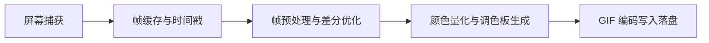

# 轻量/小而美 GIF 录制与制作工具调研报告

> 调研日期：2026-11-01  
> 适用平台：Windows 10 / 11（部分支持跨平台）  
> 目标诉求：轻量、无广告/无捆绑、体验小而美、开源可二次开发与自编译打包  
> 调研对象：ScreenToGif、winshotx、LICEcap、vhs、gifski、ShareX 等主流开源项目及生态底座

---

## 1. 选型速览与决策矩阵

针对“小而美、轻量、开源且方便自己修改打包”的需求，市面上的开源 GIF 工具在**技术栈、体积、编辑能力与二次开发门槛**上呈现明显分化。下表为各维度的横向对比：

| 工具名称 | 技术栈 / 语言 | 安装包/单文件体积 | 典型内存占用 | 核心定位与特色 | 二开与打包门槛 | 开源协议 |
| :--- | :--- | :--- | :--- | :--- | :--- | :--- |
| **[ScreenToGif](https://github.com/NickeManarin/ScreenToGif)** | C# (.NET 8 + WPF) | 约 5~10 MB (依赖式) / ~60MB (单文件内嵌) | ~80 - 150 MB | **Windows 综合体验天花板**：录制+极强逐帧编辑、按键显式、调色板优化 | **极低**（Visual Studio / `dotnet publish`，代码规范架构分明） | Ms-PL |
| **[winshotx](https://github.com/Mun1to/winshotx)** | Rust + Tauri 2 (Web 前端) | **~2.2 MB** | **~33 MB** | **现代新锐 Snipping Tool 替代品**：毫秒级启动、内置简易逐帧编辑、录制 GIF/MP4 | **低**（标准 `cargo tauri build`，Rust 后端+现代 Web UI） | MIT |
| **[LICEcap](https://github.com/justinfrankel/licecap)** | C++ (Win32 / Cockos WDL) | **< 500 KB** (单 exe) | **< 15 MB** | **极致极轻古典派**：框选即录、零冗余、Winamp 作者 Justin Frankel 出品 | **中**（纯 C++ MSVC/WDL，体积无敌，但需熟悉 Win32 GDI/底层） | GPL v2 |
| **[vhs](https://github.com/charmbracelet/vhs)** | Go (+ ttyd, ffmpeg) | ~15 MB (单 CLI) | 取决于渲染 | **终端动图代码化神器**：通过 `.tape` 脚本自动化生成超高颜值终端 GIF | **极低**（标准 Go 项目，`go build` 即可出二进制） | MIT |
| **[gifski](https://github.com/ImageOptim/gifski)** | Rust (`libimagequant`) | ~5 MB (CLI) | ~50 - 100 MB | **画质天花板编码引擎**：突破 256 色限制的时间抖动算法，适合作为自研后端底座 | **低**（`cargo build`，支持 C 动态库/CLI 调用） | AGPL-3.0 |
| **[ShareX](https://github.com/ShareX/ShareX)** | C# (.NET) | ~40 MB | ~120 - 200 MB | **全能自动化管家**：截图+录屏+图床+工作流，但功能较重偏离“小而美” | **中**（项目庞大，模块繁多，二开成本高于专用工具） | GPL v3 |

---

## 2. 深度剖析：主力推荐工具

### 方案 A：ScreenToGif —— Windows 生态最成熟的“全能小而美”
- **代码仓库**：[NickeManarin/ScreenToGif (GitHub)](https://github.com/NickeManarin/ScreenToGif)
- **技术栈**：C#、.NET 8、WPF、C++/CLI
- **许可证**：Microsoft Public License (Ms-PL)

#### 为什么推荐
1. **开箱即用的完整工作流**：集成了屏幕录制、摄像头录制、画板录制，以及市面上最为精致的**逐帧编辑器（Frame Editor）**。录制完不需要借助外部工具，可以直接删减冗余帧、调整单帧延迟、裁剪画幅、添加字幕、绘制高亮框、打马赛克、显示按键。
2. **多编码引擎支持**：内置支持多种量化与编码算法（NeuQuant、Octree、Burkes、Floyd-Steinberg 抖动），并原生支持外挂或内置 `gifski` 引擎，兼顾了生成体积与色彩画质。
3. **绿色便携**：提供 Portable 单文件版，配置默认存放在软件同级目录或用户目录，不写杂乱注册表。

#### 二次开发与打包体验
- **编译工具链**：Visual Studio 2022 或直接命令行 `dotnet build -c Release`。
- **项目结构**：
  - `ScreenToGif`：主 UI 与交互层（WPF）；
  - `ScreenToGif.Model` / `ScreenToGif.Util`：核心数据模型与捕获/编码抽象；
  - `ScreenToGif.Native`：Win32 API 与底层抓屏交互。
- **打包方式**：可直接通过 .NET 的 `PublishSingleFile=true` 与裁剪（Trimming）打包出免安装可执行文件，修改界面皮肤、默认按键、增加自动化导出上传插件非常轻松。

---

### 方案 B：winshotx —— 现代新锐（Rust + Tauri 2），极度轻量与极客自改首选
- **代码仓库**：[Mun1to/winshotx (GitHub)](https://github.com/Mun1to/winshotx)
- **技术栈**：Rust、Tauri 2、TypeScript / 前端 UI
- **许可证**：MIT

#### 为什么推荐
1. **极致轻巧的资源占用**：安装包仅约 **2.2 MB**，日常内存占用约 **33 MB**，区域选择响应时间仅约 **28 ms**，彻底摒弃了 Electron 的笨重包袱。
2. **无捆绑纯净设计**：无需外挂繁重的 FFmpeg 二进制包，零遥测无上传，纯本地单机运行。
3. **专注核心能力**：涵盖区域截图、屏幕录制（GIF & MP4 格式输出）以及直观的逐帧编辑器。

#### 二次开发与打包体验
- **编译工具链**：Rust（`cargo`） + Node.js（`npm` / `pnpm`）。
- **二次开发门槛**：**对全栈或前端/Rust 开发者最友好**。
  - 界面部分是标准的现代前端 Web 技术，想改 UI 布局、换主题配色、调录制操作逻辑直接改前端代码；
  - 底层捕获与文件写入在 Rust 端，基于 Tauri 2 的 IPC 机制通信。
  - 执行 `pnpm tauri build` 即可自动化打包出 Windows 单文件安装包或绿色二进制。

---

### 方案 C：LICEcap —— 极致体积古典派（< 500KB 单文件）
- **代码仓库**：[justinfrankel/licecap (GitHub)](https://github.com/justinfrankel/licecap)
- **技术栈**：C++、Cockos WDL（Win32 GDI / DirectX 极简封装）
- **许可证**：GPL v2

#### 特性与适用场景
- **极度纯粹**：由数字音频工作站 REAPER 和经典播放器 Winamp 的作者 Justin Frankel 开发。没有现代花哨的 UI，主窗口就是一个中间镂空的透明框架，拖到哪里框住就录哪里。
- **资源极低**：单可执行文件只有 **400~500 KB**，运行时内存约 10MB，可以在极低配置或便携 U 盘环境下秒开即用。
- **不足**：无逐帧编辑面板，录制前必须精确对齐，适合“录完就走”的纯文本/Bug 快速重现汇报。

---

### 方案 D：vhs —— 程序员与命令行场景的“降维打击”
- **代码仓库**：[charmbracelet/vhs (GitHub)](https://github.com/charmbracelet/vhs)
- **技术栈**：Go、ttyd、ffmpeg
- **许可证**：MIT

#### 特性与适用场景
- **动图代码化（GIF as Code）**：专门面向终端命令行演示。无需手动开启录屏软件和小心翼翼地敲键盘，而是编写一个简单的 `.tape` 脚本：
  ```tape
  Output demo.gif
  Set FontSize 16
  Set Width 800
  Set Height 400

  Type "cargo build --release"
  Sleep 500ms
  Enter
  Sleep 2s
  ```
- **输出品质极佳**：自动渲染出带有终端窗口阴影、极高字体平滑度、精准控制击键延迟的高颜值 GIF，常用于开源项目 README 和技术博客。

---

### 方案 E：闭源经典对照 —— GifCam
- **官网**：BahraniApps (Isa)
- **特性**：单文件仅 1.6 MB，极度经典的单窗口拖拽录制，支持简易单帧删除与空闲帧延迟压缩。
- **缺点**：**闭源（Freeware）**，作者未公开源代码，无法自行修改源码或定制打包。

---

## 3. 自研 / 二开关键技术选型指南

如果你倾向于**自编译、修改甚至参考优秀架构自己手搓一个最契合个人工作流的轻量 GIF 录屏工具**，核心链路的拆解与技术选型建议如下：



### 1. 屏幕捕获层（Windows）
- **老派方案**：Win32 GDI (`BitBlt`) —— 实现简单、兼容性好，但高分辨率或高帧率下 CPU 占用高、容易掉帧。
- **现代方案（推荐）**：
  - **Desktop Duplication API (DXGI)**：基于 DirectX 11，直接从 GPU 显存拷贝画面，速度极快（< 5ms/帧）。
  - **Windows.Graphics.Capture (WGC)**：Win10 1803+ 官方推荐的现代捕获 API，支持指定单窗口/区域捕获，自带硬件加速和黄色/无边框遮罩。

### 2. 帧差优化（减小 GIF 体积的关键）
GIF 规范支持设置一帧中未发生变化的区域为透明（Transparency Index）并使用 `Restore to Previous` 或 `Do Not Dispose` 策略。
- 优秀的录屏工具（如 ScreenToGif、winshotx）都会在内存中比对前后两帧像素；
- 仅把产生像素差异的“最小脏矩形（Dirty Rect）”编码进下一帧，静止不动的区域完全不消耗体积。

### 3. 颜色量化与调色板生成（决定画质）
GIF 标准限制单帧全局最多 256 色。若直接硬转换会出现严重的色彩断层（banding）。
- **轻量快速**：Octree（八叉树算法）或 NeuQuant（神经网络量化）；
- **极致画质（推荐接入）**：引入 Rust 的 **`gifski`**（基于 `libimagequant`），其利用帧间抖动（Temporal Dithering），在视觉上达到逼近真彩色的效果。

### 4. 推荐的二开基底
- **如果偏好 C# 生态**：直接基于 `ScreenToGif` 精简。砍掉不需要的导出格式（如 PSD、Avi 等）和重型翻译包，只保留核心录屏与轻量 Editor，编译产物清爽紧凑。
- **如果偏好 Rust / Web 生态**：直接 Fork `Mun1to/winshotx`。Tauri 2 架构极其清晰，Web 前端定制 UI 与快捷键无心智负担，Rust 端掌控高性能录制。

---

## 4. 落地建议

1. **直接开箱使用 + 偶发需要帧修剪**：首选 **ScreenToGif 便携版**（Windows 下无可争议的生产力王牌）；
2. **需要极致轻巧 + 偏好现代 Rust/Tauri 技术栈二次定制**：首选 **winshotx**（MIT 协议、极简纯粹、`tauri build` 打包无外部大依赖）；
3. **针对命令行/开发工具做演示动图**：首选 **vhs**（脚本声明式生成，质感断层领先）；
4. **如果需要对已有视频提取高质量 GIF**：使用 `ffmpeg` 提取帧序列后输入给 `gifski` 编码。
