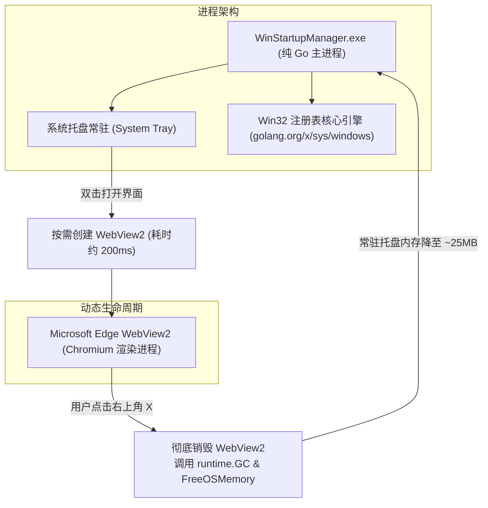

# Windows 开机自启可视化管理工具 (WinStartupManager) 产品需求与规格说明书 (PRD)

> **spec 编号**：04 ｜ **项目代号**：`winstartupmanager` ｜ **阶段**：Phase 1 (聚焦注册表) ｜ **日期**：2026-10-18  
> **文档状态**：实施就绪 (Ready for Implementation)

---

## 一、产品定位与阶段目标

### 1.1 背景与痛点
Windows 原生任务管理器的【启动应用】仅提供极简的软开关，无法清晰查看注册表键值、真实启动参数、工作目录，亦无法安全地增删条目或清理无效残留项；而微软官方的 Sysinternals Autoruns 界面极其繁复底层、缺少现代审美与安全拦截。对于开发者与进阶用户，迫切需要一款**轻量透明、界面现代、无损启停、支持注册表深度管理**的开机自启可视化工具。

### 1.2 阶段规划
- **Phase 1（本期核心）**：
  - **核心战场**：全方位纳管 **Windows 注册表自启动项**（`HKCU/HKLM Run`、`RunOnce`、`WOW6432Node`）；
  - **核心壁垒**：完全对齐任务管理器底层 **`StartupApproved\Run`** 二进制位翻转机制，实现**真·无损启用与禁用**；
  - **辅助视窗**：启动文件夹（Startup Folders）与开机计划任务（Scheduled Tasks）在第一期作为**聚合只读审计看板**接入；
  - **严格排除**：明确**排除 Windows 系统服务（Services）**，严防误关系统底层驱动和关键网络组件导致系统不稳定。
- **Phase 2（远期规划）**：
  - 启动文件夹与计划任务的双向写操作（创建/编辑快捷方式与触发器）；
  - 启动耗时分析（基于 Windows Event Log 追踪各软件开机启动耗时）。

---

## 二、技术选型与低内存架构基线

根据知识库手记 **[`071_dev_wails_fix_WailsV3WebView2高内存治理`](file:///C:/Users/29580/.agents/skills/kb-engineering-notes/071_dev_wails_fix_WailsV3WebView2高内存治理与关窗生命周期重构.md)** 的实战沉淀，本项目确立以下技术底座与工程不变式：



### 2.1 技术栈选择
- **后端框架**：Go 1.23+ / Wails v3
- **前端框架**：Vue 3 + Vite + TailwindCSS（现代亮色风格、圆角卡片、信息高密度）
- **底层通信**：纯 Go 原生调用 `golang.org/x/sys/windows/registry`，**严禁裸调 PowerShell 进程**（避免 200~500ms 进程冷启动延迟与黑框闪烁）。

### 2.2 WebView2 启动参数剪枝与内存治理硬约束
在 `application.New` 构造中，必须注入以下 Windows 专有配置：

1. **Chromium 参数剪枝（砍掉独立 GPU 进程与网络服务）**：
   ```go
   AdditionalBrowserArgs: []string{
       "--disable-gpu",                                // 禁用独立 GPU 硬件加速进程（省 ~67MB）
       "--disable-gpu-compositing",                    // 禁用 GPU 合成
       "--disable-software-rasterizer",                // 禁用软件光栅化组件
       "--renderer-process-limit=1",                   // 强制限单渲染进程
       "--disable-features=NetworkServiceOutOfProcess", // 将 Network 服务并入主进程（省 ~44MB）
   }
   ```
2. **生命周期按需重构（关窗即销毁，呼出即重建）**：
   - 配置 `WindowsOptions.DisableQuitOnLastWindowClosed: true`；
   - 监听窗口 `WindowClosing` 钩子，**不拦截、放行销毁原生窗口与 WebView2**，并将 Go 端窗口引用置空；
   - 关窗后异步执行 `runtime.GC()` 与 `debug.FreeOSMemory()` 归还堆内存给操作系统；
   - 托盘常驻闲置内存由传统的 350MB **强制压降至 ~40MB 级别**。
3. **开机自启（`--hidden`）冷启动零 Chromium 实例**：
   - 若进程带 `--hidden` 参数启动（如开机常驻监控），**初始完全不拉起 WebView2 实例**，仅运行纯 Go 托盘与后台监听，常驻内存仅 **~20MB**。

---

## 三、底层机制透视与关键技术规格

### 3.1 注册表纳管范围（Phase 1 覆盖全部 4 个物理位置）

| 物理位置标识 | 注册表根键与路径 | 作用域与权限要求 |
| :--- | :--- | :--- |
| `HKCU_Run` | `HKEY_CURRENT_USER\Software\Microsoft\Windows\CurrentVersion\Run` | 当前用户登录自启（普通用户可写） |
| `HKCU_RunOnce` | `HKEY_CURRENT_USER\Software\Microsoft\Windows\CurrentVersion\RunOnce` | 当前用户单次自启（普通用户可写） |
| `HKLM_Run` | `HKEY_LOCAL_MACHINE\Software\Microsoft\Windows\CurrentVersion\Run` | 全机所有用户自启（需要管理员权限写入） |
| `HKLM_Run_WOW64` | `HKEY_LOCAL_MACHINE\Software\WOW6432Node\Microsoft\Windows\CurrentVersion\Run` | 32位兼容层全机自启（需要管理员权限写入） |

### 3.2 任务管理器同款 `StartupApproved\Run` 无损二进制位契约
为了保证用户禁用某个启动项后，下次依然能一键恢复，**严禁采用删除或重命名键值的方式进行“禁用”**。

- **状态存储键路径**：
  - `HKCU\Software\Microsoft\Windows\CurrentVersion\Explorer\StartupApproved\Run`
  - `HKLM\Software\Microsoft\Windows\CurrentVersion\Explorer\StartupApproved\Run`
  - `HKLM\Software\Microsoft\Windows\CurrentVersion\Explorer\StartupApproved\Run32`
- **键名**：与 `Run` 键下的目标条目名完全一致；
- **类型**：`REG_BINARY`，长度固定为 12 字节；
- **二进制状态判决算法**：
  - 若在 `StartupApproved` 下**不存在该键名**：判定为 **默认启用 (`true`)**；
  - 若存在且**第 0 个字节为偶数**（如 `0x02`, `0x00`, `0x06`）：判定为 **启用 (`true`)**；
  - 若存在且**第 0 个字节为奇数**（如 `0x03`, `0x01`）：判定为 **禁用 (`false`)**。
- **状态翻转写入规格**：
  - **置为启用**：写入 `[]byte{0x02, 0x00, 0x00, 0x00, 0x00, 0x00, 0x00, 0x00, 0x00, 0x00, 0x00, 0x00}`；
  - **置为禁用**：写入 `[]byte{0x03, 0x00, 0x00, 0x00, <8字节时间戳>}`（前4字节 `0x03 0x00 0x00 0x00` 即可）。

---

## 四、功能性需求详述 (FR)

### FR-1: 注册表自启动项聚合扫描 (Registry Scan)
- 启动或点击刷新时，毫秒级遍历上述 4 个注册表路径下的全部键值；
- 结合 `StartupApproved` 映射表，输出统一结构化的启动项列表；
- 命令行智能拆解：将形如 `"C:\Program Files\App\app.exe" --startup /min` 的长串，安全提取出**纯净可执行文件路径 (`ExePath`)** 与 **附加参数 (`Arguments`)**。

### FR-2: 启动项健康审计与数字签名校验 (Health & Signature)
- **文件存在性校验 (`FileExists`)**：基于 `ExePath` 进行 `os.Stat` 探测；若目标文件已不存在（残留的无效卸载项），在 UI 显式标记为浅红“无效残留项”，并支持一键清理；
- **数字签名提取 (`Publisher`)**：调用 Win32 原生 API `WinVerifyTrust` 与 `CryptQueryObject` 提取发布者公司名（如 `Microsoft Corporation`、`Google LLC`）；若无签名则标记为“无数字签名”。

### FR-3: 任务管理器同款无损启停 (Toggle Enable/Disable)
- 在 UI 上以 Switch 开关形式展示；
- 切换时直接修改对应 `StartupApproved` 键值二进制位，**绝不改动原启动项命令**；
- 变更后无需重启系统，Windows 任务管理器即时同步识别状态。

### FR-4: 安全硬删除与预删除自动快照 (Delete & Safety)
- 用户点击“删除”操作时，弹出强制二次确认模态框；
- **预删除快照**：在执行底层 `registry.DeleteValue` 前，必须自动在 `%LOCALAPPDATA%\WinStartupManager\backups\` 目录下落盘该条目的 `.reg` 文本备份；
- 同步清理 `StartupApproved` 中的对应历史标记，确保注册表纯净。

### FR-5: 新增与编辑注册表启动项 (Add & Edit)
- 提供“新增自启动项”对话框：
  - 目标作用域：单选 `当前用户 (HKCU Run - 推荐)` 或 `全机系统 (HKLM Run - 需提权)`；
  - 启动项名称 (`Name`)：必填；
  - 程序路径 (`Path`)：提供原生 Windows 文件选择器，或支持手动粘贴路径；
  - 附加参数 (`Args`)：可选；
- 提供“编辑”功能：允许修改已有启动项的名称、执行路径与参数。

### FR-6: 系统级定位与联动 (System Navigation)
- **在文件管理器中定位**：点击后直接调用 `explorer.exe /select,"<ExePath>"` 唤起资源管理器并精准高亮选中该可执行文件；
- **在注册表编辑器中定位**：通过写入 `HKCU\Software\Microsoft\Windows\CurrentVersion\Applets\Regedit\LastKey`，随后启动 `regedit.exe`，直接跳转高亮到该条目所在位置。

### FR-7: 备份快照与一键还原 (Backup & Restore)
- **整仓备份**：支持将当前全部注册表自启动项导出为标准的 `.reg` 注册表脚本或 JSON 快照文件；
- **还原恢复**：支持导入此前导出的备份文件，自动补齐缺失项。

### FR-8: 辅助只读看板（启动文件夹与计划任务）
- 设立两个辅助 Tab 标签页：
  - **启动文件夹**：只读遍历 `%APPDATA%` 与 `%ProgramData%` 下的 Startup 目录，解析展示快捷方式（`.lnk`）的目标路径与启用状态；
  - **计划任务**：只读扫描系统计划任务中触发条件为“登录时 (Logon)”或“启动时 (Boot)”的第三方开机任务。
- 第一期仅做聚合展示与健康探测，不开放写操作，保持核心功能收敛。

---

## 五、数据契约与接口设计 (Go API)

```go
package model

type StartupSource string

const (
	SourceRegistryHKCU      StartupSource = "HKCU_Run"
	SourceRegistryHKCURunOnce StartupSource = "HKCU_RunOnce"
	SourceRegistryHKLM      StartupSource = "HKLM_Run"
	SourceRegistryHKLMWOW64 StartupSource = "HKLM_WOW6432Node"
	SourceStartupFolderUser StartupSource = "Folder_User"
	SourceStartupFolderCommon StartupSource = "Folder_Common"
	SourceTaskScheduler     StartupSource = "TaskScheduler"
)

type StartupItem struct {
	ID          string        `json:"id"`           // MD5(Source + Name)
	Source      StartupSource `json:"source"`       // 来源物理分类
	Name        string        `json:"name"`         // 注册表键名 / 任务名
	RawCommand  string        `json:"raw_command"`  // 原始命令行整串
	ExePath     string        `json:"exe_path"`     // 解析后的纯净 exe 路径
	Args        string        `json:"args"`         // 启动参数
	IsEnabled   bool          `json:"is_enabled"`   // 当前是否已启用
	FileExists  bool          `json:"file_exists"`  // 文件是否存在
	Publisher   string        `json:"publisher"`    // 数字签名签名方
	IsElevated  bool          `json:"is_elevated"`  // 是否需要管理员权限修改 (HKLM 项)
}

// 后端对外暴露的 Wails 绑定服务
type StartupAppService struct{}

func (s *StartupAppService) ListRegistryItems() ([]StartupItem, error)
func (s *StartupAppService) ListFolderItems() ([]StartupItem, error)
func (s *StartupAppService) ListScheduledTasks() ([]StartupItem, error)

func (s *StartupAppService) ToggleItem(id string, enable bool) error
func (s *StartupAppService) DeleteItem(id string) error
func (s *StartupAppService) SaveItem(source StartupSource, name string, exePath string, args string) error

func (s *StartupAppService) LocateInExplorer(exePath string) error
func (s *StartupAppService) LocateInRegistry(source StartupSource, name string) error
func (s *StartupAppService) ExportBackup(destPath string) error
```

---

## 六、非功能性需求与架构防线 (NFR)

1. **零进程卡顿与内存底噪**：
   - 首次全量扫描耗时 ≤ 150ms（通过并行 goroutine 扫描不同注册表根）；
   - 窗口展示态物理内存 ≤ 180MB；关窗退入托盘后物理内存 **≤ 40MB**；自启 `--hidden` 冷启动内存 **≤ 25MB**。
2. **UAC 权限降级与局部提权**：
   - 应用程序严禁在清单 (`app.manifest`) 中强行声明 `requireAdministrator`；
   - 默认以普通权限（`asInvoker`）静默启动，满足 95% 的查看与 `HKCU` 操作诉求；
   - 仅当用户尝试修改 `HKLM` 注册表项时，调用 Windows 原生 `ShellExecuteEx` (`verb: "runas"`) 拉起专用的极小命令行提权助手完成操作，杜绝日常运行时的 UAC 弹窗骚扰。
3. **防杀毒软件误杀**：
   - 不生成任何用于修改注册表的临时 `.bat` 或 `.vbs` 脚本；
   - 二进制产物嵌入合法应用程序图标、版本描述与标准 DPI 感知 Manifest。

---

## 七、验收标准 (Acceptance Criteria)

### AC-1: 注册表扫描与任务管理器完全一致
- **WHEN** 打开应用主界面；
- **THEN** 界面列出的 HKCU 与 HKLM 注册表自启项与 Windows 任务管理器【启动应用】完全对齐，且显示其真实可执行文件路径与有效性状态。

### AC-2: 无损软启停与同步生效
- **WHEN** 在界面中将某个启动项开关由【开】拨为【关】；
- **THEN** 该项底层注册表 `Run` 命令行未被篡改，而 `StartupApproved\Run` 对应二进制位被成功置为 `0x03`；打开系统自带任务管理器，该项状态同步显示为【已禁用】。

### AC-3: 关窗内存完全释放
- **WHEN** 用户点击窗口右上角 `[X]`；
- **THEN** 窗口立即关闭，托盘图标继续保持存活，任务管理器中 WebView2 相关子进程彻底退出，应用总 WorkingSet 内存降至 40MB 以下；双击托盘能正常在 300ms 内重新呼出界面。

### AC-4: 破坏性操作安全防御
- **WHEN** 用户点击某条目的【删除】按钮；
- **THEN** 弹窗要求确认，确认后自动在应用备份目录生成 `.reg` 备份文件后再执行删除，并提供成功提示。

---

## 八、未决问题与阻塞确认清单
- [ ] **问题 1（提权交互实现路径）**：针对修改 `HKLM` 时的 UAC 局部提权，是选择内嵌一个带 `--elevated-helper` 参数自调用的子进程模式，还是提供一个一键以管理员权限重启整个主程序的按钮？（推荐：一键“以管理员权限重新启动”模式，代码复杂度最低且交互最清晰）。
- [ ] **问题 2（前端构建工具偏好）**：前端技术栈是否锁定为 Vite + Vue 3 + TailwindCSS？
