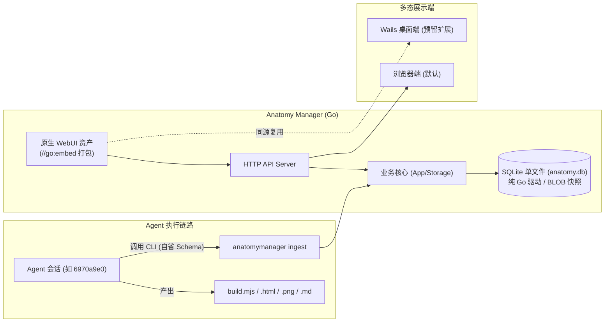

# Design Document: Anatomy Manager

## Overview
Anatomy Manager 是一个面向 `anatomy` 技能产物生命周期的轻量 Go 桌面管理服务端，集成了 SQLite 单文件快照存储、CLI/JSON Schema 交互契约、RESTful HTTP API、以及内嵌的单文件 WebUI 工作台。

## Context
在多 Agent 协同体系中，执行 `anatomy` 生成精密机械分解与交互图谱后，产物分散在各自的会话目录（如 `rate-limiter-anatomy.md` 在 session brain，HTML/PNG 在 examples 目录）。需要一个常驻或随调随走的单一二进制管理工具，将分散产物收束归档入库，并对外提供高保真渲染服务。

## Goals and Non-Goals
- **Goals**:
  - 纯 Go 实现，零 CGO，跨平台单文件二进制发布。
  - 单文件 SQLite 持久化全量资产（包含 BLOB 二进制）。
  - CLI 与 HTTP 两种摄取通道，配套标准 JSON Schema。
  - 纯原生单页 WebUI，零前端构建链。
- **Non-Goals**:
  - 本阶段不引入重型前端框架（如 React/Vue）。
  - 不强行打包完整的 Wails 二进制（仅做前端与服务层解耦兼容），保持体积极简。

## Detailed Design

### 1. 存储层设计 (`internal/storage/sqlite.go`)
- 采用 `modernc.org/sqlite` 纯 Go 驱动，无需 gcc / CGO。
- **表结构**：
  - `artworks`: `id (PK)`, `title`, `category`, `description`, `tags`, `session_id`, `primary_html`, `doc_markdown`, `created_at`, `updated_at`
  - `artifact_files`: `id (PK)`, `artwork_id (FK)`, `file_name`, `file_type`, `mime_type`, `size_bytes`, `content_blob`, `created_at`
- **文件入库事务**：先 Upsert `artworks`，随后级联遍历文件写入 `artifact_files`。

### 2. CLI 架构设计 (`cmd/anatomymanager/main.go`)
- 模块子命令路由：
  - `ingest`: 摄取归档，支持 `--name`, `--title`, `--dir`, `--doc`, `--session-id`, `--json`。
  - `list`: 列出已收录图谱，支持 `--json`。
  - `get <id>`: 查询指定图谱元数据与文件列表。
  - `schema <ingest|artwork>`: 打印标准 JSON Schema。
  - `export <id> --out <dir>`: 逆向将 SQLite 中的文件解构落地到磁盘。
  - `serve --port <port> [--open]`: 启动 WebUI 预览服务。

### 3. WebUI 与 HTTP 服务层 (`internal/api/`, `internal/web/`)
- 基于 Go 1.16+ `embed.FS` 将 `internal/web/assets`（HTML、CSS、JS）打包进二进制。
- **HTTP 路由**：
  - `/api/artworks`: GET 返回图谱列表。
  - `/api/artworks/:id`: GET 返回图谱元数据。
  - `/api/artworks/:id/files/:filename`: 静态文件流式传输，附带正确的 MIME 与 Cache-Control。
  - `/`: 静态文件根目录托管 WebUI 单页应用。
- **WebUI 交互功能**：
  - 左侧：图谱卡片列表、搜索过滤、缩略图展示。
  - 顶部工具栏：深色/浅色版本切换、独立标签页打开。
  - 视窗主体：`<iframe>` 沙箱加载交互式 SVG 图谱。
  - 辅助选项卡：Markdown 机械原理原理解析、`build.mjs` 源码预览、SQLite 资产列表。

### Acceptance Criteria Mapping
| AC ID | Design Component |
|---|---|
| AC-1: 产物摄取正确性 | `handleIngest` + `storage.SaveArtwork` (SQLite BLOB upsert) |
| AC-2: CLI 格式自描述 | `handleSchema` 输出内置 JSON Schema 结构 |
| AC-3: 离线沙箱渲染 | `api.Server` + `web.Assets` (iframe 跨域隔离沙箱) |
