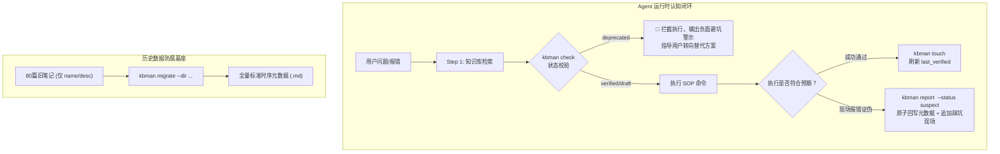

# Design Document: 知识库时序防腐与生命周期治理引擎 (kbman)

## Overview
`kbman` 是专为工程知识库 `kb-engineering-notes`（及衍生体系）打造的 Go 语言时序元数据防腐治理工具。通过提供批处理迁移、前置拦截自检与运行时回写接口，形成完整的生命周期闭环。



## Detailed Design

### 1. 结构与模块划分 (`go_projects/kbman`)
```text
kbman/
├── cmd/
│   └── kbman/
│       └── main.go         # CLI 入口 (migrate, check, report, touch, audit)
├── internal/
│   ├── parser/             # Markdown 与 YAML Frontmatter 双向解析器
│   ├── metadata/           # 契约实体定义 (Metadata, FalsificationSignal 等)
│   └── service/            # 核心业务服务 (Migrator, Auditor, Governance)
├── go.mod
└── README.md
```

### 2. 元数据标准实体定义 (`internal/metadata/metadata.go`)
```go
type Metadata struct {
	ID                   string   `yaml:"id"`
	Domain               string   `yaml:"domain"`
	Scope                string   `yaml:"scope"`
	Type                 string   `yaml:"type"`
	Slug                 string   `yaml:"slug"`
	Status               string   `yaml:"status"` // verified, draft, suspect, deprecated
	Created              string   `yaml:"created"`
	LastVerified         string   `yaml:"last_verified"`
	SupersededBy         *string  `yaml:"superseded_by,omitempty"`
	DeprecationReason    *string  `yaml:"deprecation_reason,omitempty"`
	FalsificationSignals []string `yaml:"falsification_signals,omitempty"`
	Tags                 []string `yaml:"tags,omitempty"`
}
```

### 3. 旧笔记安全升级引擎 (`internal/service/migrator.go`)
- 正则提取文件名五段式：`^(?P<id>\d{3})_(?P<domain>[a-z]{2,8})_(?P<scope>[a-z0-9]{2,8})_(?P<type>fix|flow)_(?P<slug>.+)\.md$`
- 保留旧 frontmatter 中的 `description` 与其他自定义字段；
- 将历史条目基线统一注入 `status: verified`、`created: 2026-09-22`（或 Git 创建时间）、`last_verified: 2026-10-20`；
- 无 BOM UTF-8 写回，保持换行符一致。

### 4. 运行时防御与回写接口 (`cmd/kbman/main.go`)
- `kbman check <id|file>`：
  - 读取 frontmatter；
  - 若 `status == deprecated`，退出码 2，输出 `[BLOCKED] 该方案已废弃！替代条目: ...`；
  - 若 `status == suspect`，退出码 1，输出 `[WARN] 该方案近期存疑，请先通过只读命令核验环境`；
  - 若 `status == verified`，退出码 0，允许执行。
- `kbman report <id> --status <status> [--reason <reason>] [--append <log>]`：
  - 原子替换 `status`；
  - 若有 `--append`，在正文最底部追加带时间戳的 `### 踩坑回写记录`。

### Acceptance Criteria Mapping
| AC ID | Component |
|---|---|
| AC-1: 历史文件 100% 格式无损升级 | `service.Migrator` 批量升级 80 个条目 |
| AC-2: 防御性拦截判定 | `cmd.handleCheck` 根据 status 返回不同退出码与决策建议 |
| AC-3: 自愈回写原子操作 | `service.Governance.UpdateStatus` 与追加排障日志 |